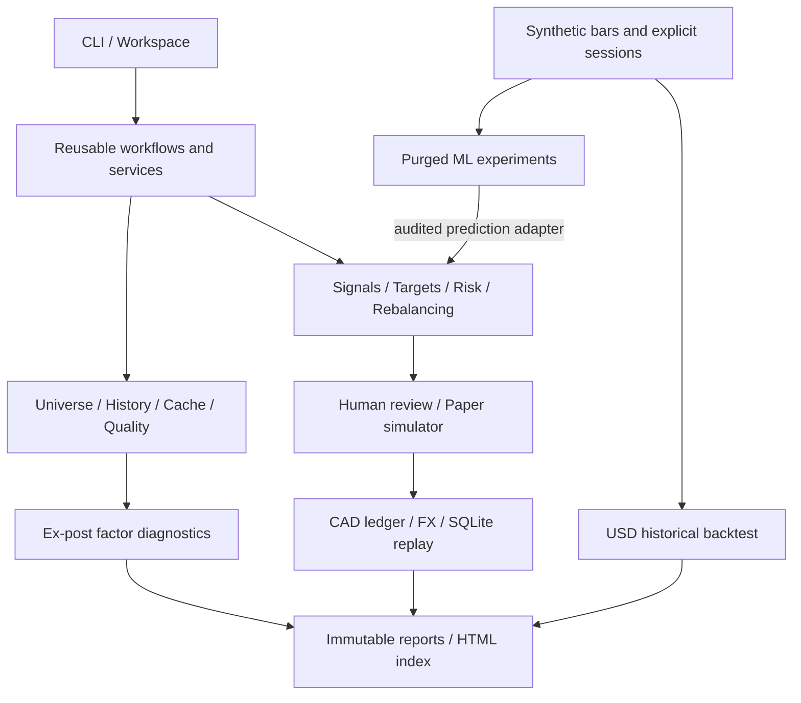

# PortfolioResearchDesk

A local-first Python desk for equity research, reproducible model experiments,
portfolio risk checks and reviewed CAD paper trading.

**Development version 0.7.0 · Phase 6 final acceptance.** Local validation is complete;
the user has authorized safe synchronization to the existing private repository. See the
[Phase 6 acceptance record](docs/PHASE_6_REPORT.md) for actual validation and status.

This project demonstrates research and software engineering. Synthetic examples
verify behavior; they do **not** establish a profitable strategy. Real factor
research is descriptive, historical membership is unverified, and real-market
point-in-time (PIT) / out-of-sample (OOS) performance is not certified. There is no
broker connection or real-order execution.

## Features

- **Universes and data:** custom watchlists, current Nasdaq directories, combined
  screening, yfinance and native CSV/Parquet adapters, immutable local caches,
  quality checks, timestamps and provenance.
- **Factor research:** common-sample FF3 / Carhart FF4 OLS, classical or HC3
  inference, diagnostics and trailing exposures. These are ex-post explanations.
- **Model experiments:** prior, Logistic, Lasso, Random Forest and XGBoost;
  training-only preprocessing, nested date-grouped purged walk-forward tuning,
  frozen holdout and comparisons with simple portfolio benchmarks.
- **Portfolio construction:** transparent Top-K targets or explicit weights,
  integer shares, position/sector/cash/trade limits and next-session simulation.
- **CAD paper accounting:** CAD/USD cash and assets, available FX, fees and
  slippage, raw-price valuation, limited explicit corporate actions, atomic
  SQLite events, hash-bound human review and restart/idempotency checks.
- **Product workflow:** environment diagnostics, editable workspace templates,
  readable Paper JSON, a single offline demo, local HTML report index and
  artifact verification. No server or dashboard dependency is required.

## Install

Requirements: **Python 3.12.x** and **uv 0.13.6**. From an authorized clone:

```bash
python -m pip install uv==0.13.6
uv sync --locked --extra data --extra factors --extra ml --python 3.12
uv run --locked --offline prd doctor --require factors --require ml
```

On Windows, use `py -3.12 -m pip` if `python` selects another interpreter.
If `uv` is not on PATH, use `py -3.12 -m uv` (Windows) or `python3.12 -m uv`.
Initial provisioning needs network access. With a populated cache, add `--offline`
to `uv sync`. No activation or API key is required for the examples.

The base package has no third-party runtime dependency: `uv sync --locked` is
sufficient for the core demo and native CSV research. Extras enable live/Parquet
`data`, scientific `factors`, and `ml`. Full development tests need all three.
The lock fixes dependency versions; it does not license third-party datasets.

## Quick Start

Create a new local workspace and run the complete **synthetic 3,000 CAD** example:

```bash
uv run --locked --offline prd workspace init --directory work/my-desk
uv run --locked --offline prd workflow run --config work/my-desk/workflow.toml --run-id first
uv run --locked --offline prd workflow check --directory work/my-desk/runs/first
```

Open `work/my-desk/runs/first/index.html` locally. It links the imported watchlist,
past-only research signals, a separate USD backtest, proposed weights/orders,
simulated CAD trades, account valuations and replay evidence. Each run uses a new
directory and writes `workflow.json` last. Existing workspaces/runs are never
overwritten. Editing `watchlist.csv` does not retarget this fixed demo; use the
individual commands below for your own inputs.

Include the factor and ML modules:

```bash
uv run --locked --offline prd workflow run --config work/my-desk/workflow.toml --run-id full --with-factors --with-ml
```

The factor fixture is independent ex-post diagnostics. ML uses a longer independent
synthetic fixture and also produces an **unexecuted, pending-review** CAD proposal
from the development-selected model. Holdout results do not select the model.
The main CAD demonstration uses past momentum; no combined performance claim is made.
Scripted approval is restricted to the explicitly synthetic demo. Daily paper
plans require a separate explicit review of the exact plan hash.

## Daily use

| Task | Entry point | Guide |
|---|---|---|
| Diagnose Python and selected extras | `prd doctor --require ml` | [User guide](docs/USER_GUIDE.md) |
| Import, edit and export watchlists | `prd universe watchlist --help` | [Data policy](docs/DATA_POLICY.md) |
| Fetch / screen a configured universe | `prd universe build`, `prd data fetch` | [User guide](docs/USER_GUIDE.md) |
| Fit descriptive factors | `prd research run --config ...` | [Factor methodology](docs/FACTOR_RESEARCH.md) |
| Run synthetic ML comparisons | `prd ml run --config ...` | [Model validation](docs/MODEL_VALIDATION.md) |
| Run synthetic historical simulation | `prd backtest run --config ...` | [Backtest assumptions](docs/BACKTEST_ASSUMPTIONS.md) |
| Create CAD account and plan | `prd paper init`, `prd paper plan --snapshot ...` | [Manual walkthrough](docs/USER_GUIDE.md#manual-paper-lifecycle) |
| Review, simulate, value, recover, export | `prd paper --help` | [Paper accounting](docs/PAPER_TRADING.md) |

Commands emit JSON on stdout, diagnostics on stderr, and exit **2** for expected
input/operating errors. `--help` documents command-specific parameters. Strict
TOML/JSON validation rejects unknown fields rather than silently ignoring them.
Relative paths inside configuration files resolve from the file's directory.
Use `prd config validate --kind workflow` (or `research`, `factors`, `ml`, `paper`,
`backtest`) before running edited profiles. Templates are in `configs/` and
`prd workspace init` also works from an installed wheel outside the repository.

**`uv --offline` only controls dependency resolution.** Real research commands can
still request market data. Application-level `--offline` on the data/research
commands requires existing valid caches and prohibits those source requests.
`workflow run` is always synthetic/offline and has no live mode or data fallback.

## Architecture



The modular monolith separates provider observations from executable price bars,
and historical simulation from persistent paper accounts. Core computations do
not depend on CLI, UI or a provider. Historical inputs must satisfy
`available_at <= decision_at < execution_at`; a close signal executes at a later
explicit session. See [Architecture & Code Walkthrough](docs/CODE_WALKTHROUGH.md)
for a reading order, equations, algorithms and traceable examples, and
[architecture decisions](docs/ARCHITECTURE.md) for phase history.

## Test and build

After installing all extras:

```bash
uv lock --check --offline
uv run --locked --offline pytest -p pytest_socket -q
uv run --locked --offline ruff check .
uv run --locked --offline ruff format --check .
uv build --offline --no-build-isolation --out-dir dist/phase6
uv run --locked --offline python scripts/verify_distribution.py dist/phase6 --with-factors --with-ml
uv run --locked --offline python scripts/inspect_licenses.py
```

Use an empty distribution output directory. Tests prohibit sockets and use fixed
synthetic inputs; the install checker rebuilds the sdist and tests both wheels in
separate environments outside the source tree, including workspace/demo/recovery
and optional full workflows. GitHub Actions is configured for Ubuntu and Windows.
The final acceptance rerun passed **689 tests** locally, retaining all prior
regressions. Exact commit, Ubuntu/Windows CI and synchronization evidence are
recorded in [Phase 6 acceptance](docs/PHASE_6_REPORT.md). macOS is not validated.

## Limits, license and next steps

Real historical universe membership, delisted assets, identity changes and an
authoritative exchange calendar remain incomplete. Provider observation times,
corporate-action histories and factor revisions do not establish historical
availability. The CAD ledger supports supplied simple splits/dividends, not all
corporate actions or tax reporting. Its recorded NAV is a snapshot; refresh it
with explicit quotes/FX after economic changes. Conservative integer sizing may
leave substantial cash and differs from target weights. Small-account feasibility
and gap risk can reject a whole batch. No return or model score guarantees profit.

Original project code and synthetic fixtures use the user-confirmed [MIT license](LICENSE).
See [third-party notices](THIRD_PARTY_NOTICES.md) for separate software/data rights.
Keep real data, accounts and credentials in ignored directories; do not publish
raw observations or private reports without permission.

Phase 6 prioritizes reproducible local delivery and documentation. Streamlit is
deferred: shared services plus local HTML meet the current workflow without a new
server/session-state surface. Further real-data/PIT research, additional calendars
and any dashboard require explicit future scope and validation. See
[release readiness](docs/RELEASE_READINESS.md), [contributing](CONTRIBUTING.md),
[project plan](docs/PROJECT_PLAN.md) and [changelog](docs/CHANGELOG.md).
