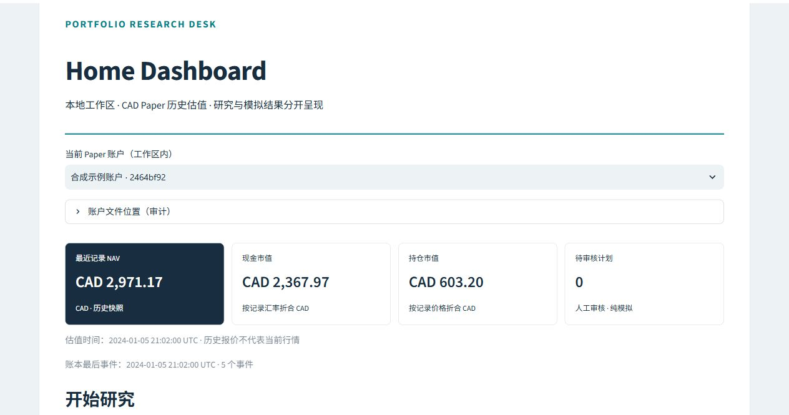
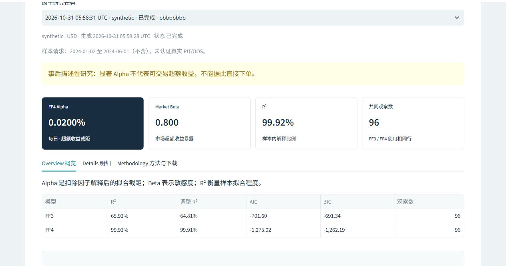
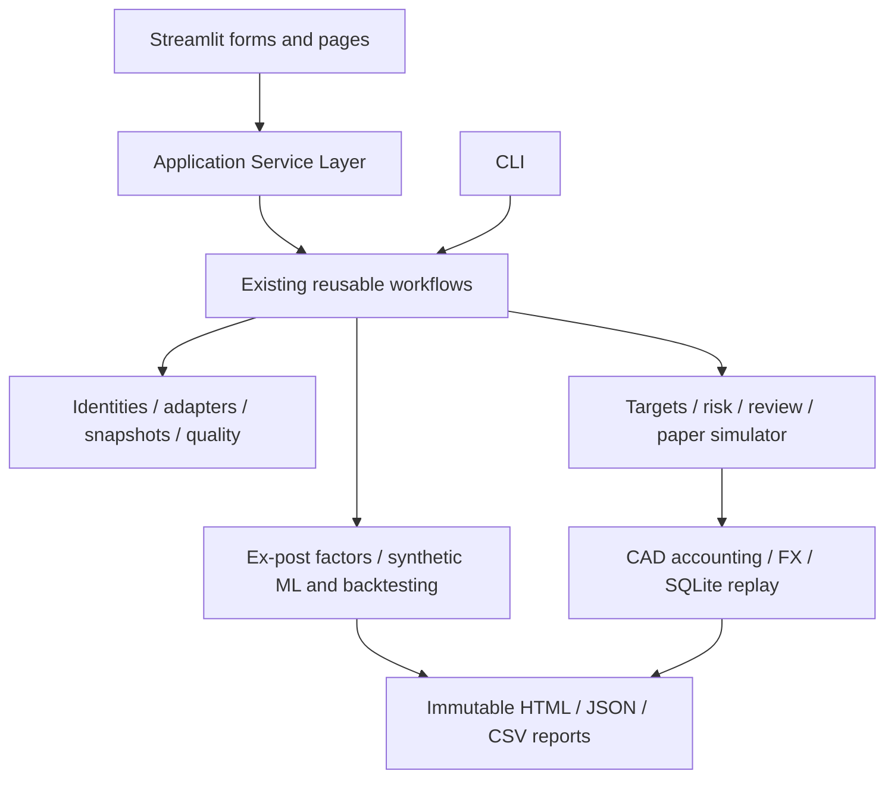

# PortfolioResearchDesk

[](https://github.com/yufeizhang06/PortfolioResearchDesk/actions/workflows/ci.yml)
[](LICENSE)

## Project Overview

PortfolioResearchDesk is a local-first Python workbench for equity research,
factor attribution, reproducible model experiments and reviewed CAD paper trading.
It combines a CLI, an optional Streamlit GUI and self-contained HTML reports.

**Version 0.7.0 · Early Beta / Work in Progress · No formal v1.0 release.**
The first GUI covers Home → Stock Explorer → Factor Research. The backend has
broader capabilities than the GUI. This is a research and software engineering
project, not a production investment or brokerage service.

Synthetic examples verify software behavior. Their returns, balances and model
scores are **not real investment performance**. Real-market point-in-time (PIT)
and out-of-sample (OOS) strategy performance are not certified. There is no broker
connection, real-order execution, short selling or leverage.

## Features & Screenshots

- **Data:** explicit security identities, versioned watchlists, current Nasdaq
  directories, screening, native CSV/Parquet and opt-in yfinance adapters,
  quality checks and immutable local caches.
- **Factors:** common-sample FF3 / Carhart FF4, classical or HC3 covariance,
  coefficient intervals, diagnostics and rolling exposures. These are ex-post
  explanations, not forecasts or tradeable alpha signals.
- **Models:** prior, Logistic, Lasso, Random Forest and XGBoost; training-only
  preprocessing, date-grouped purged walk-forward validation, frozen holdout
  and simple strategy comparisons on supported synthetic inputs.
- **Simulation:** long-only targets, integer shares, next-session execution,
  costs, CAD/USD cash, available FX, atomic SQLite events and hash-bound human
  review for paper plans.
- **Reports:** CAD Paper, Factor, ML and Backtesting overviews, charts and
  diagnostics, exact JSON/CSV audits and self-contained HTML for A4 printing.

Actual GUI captures below use only packaged **synthetic** inputs. They are cropped
to omit machine-specific paths; no displayed financial result is edited.
The current GUI has English page names and primarily Chinese controls.



Home shows a historical CAD valuation and its clock, not a current market quote.



The factor fixture is separate from the CAD example. These results do not form a
combined investment-performance claim.

## Current Development Status

| Area | Current GUI | Existing backend / CLI |
|---|---|---|
| Home | Workspace, diagnostics, recent tasks, isolated synthetic demo | Reproducible offline workflow and artifact verification |
| Stock Explorer | Editable identities, CSV import/export, versioned watchlists, data and quality | Current Nasdaq directory and combined screening also available |
| Factor Research | Saved snapshot → check → FF3/FF4 → diagnostics/download | Synthetic or supported real ex-post research; daily/monthly contracts |
| ML & Backtesting | Scope explanation; forms pending | Synthetic model experiments and USD historical simulation |
| Portfolio & Paper | Read-only account, historical valuation and plan status | Explicit-input CAD proposal, review, simulation, valuation and replay |
| Reports & Settings | Current GUI results, integrity checks and ZIP | Legacy CLI reports remain at their original locations |

The author has confirmed that the first GUI starts and operates on Windows.
Use the [documentation index](docs/README.md) for user guides, technical contracts
and historical acceptance records. [Release Readiness](docs/RELEASE_READINESS.md)
links the exact-SHA CI evidence. Software acceptance does not certify market performance.

## Installation & Quick Start

Requirements: **Python 3.12.x**, **uv 0.13.6** and Git (or a source ZIP).

```bash
git clone https://github.com/yufeizhang06/PortfolioResearchDesk.git
cd PortfolioResearchDesk
python -m pip install uv==0.13.6
uv sync --locked --extra gui --extra data --extra factors --extra ml --python 3.12
uv run --locked --offline prd doctor --require factors --require ml
uv run --locked --offline prd-gui
```

On Windows use `py -3.12 -m pip` if `python` selects another interpreter. If `uv`
is not on PATH, use `py -3.12 -m uv` for the commands above. On another OS use
`python3.12 -m uv` if appropriate. Python 3.13+ is outside the current contract.
Initial provisioning needs network; a populated cache permits `uv sync --offline`.
No API key is needed for packaged examples.

The base CLI needs only `uv sync --locked` and has no third-party runtime dependency.
Extras enable GUI, live/Parquet data, scientific factors and ML. Full development
checks require all four extras. Versions and hashes are fixed in [uv.lock](uv.lock).

### Windows double-click startup

1. Install Python 3.12 and uv 0.13.6 once.
2. Double-click **Setup GUI.cmd**. It installs the locked extras without configuration
   edits. It accepts uv on PATH or `py -3.12 -m uv`; a local developer uv copy is optional.
3. Double-click **Start GUI.cmd** and open [127.0.0.1:8501](http://127.0.0.1:8501).
   Keep the launcher running; close it to stop. If the port is occupied, close the
   earlier PRD launcher first.

Both launchers resolve their own directory and require no developer-computer
absolute path. Do not copy an existing `.venv` between machines: run setup again.
The GUI listens only on loopback and has no remote-user authentication or cloud mode.

### Complete synthetic demo without an API key

```bash
uv run --locked --offline prd workspace init --directory work/my-desk
uv run --locked --offline prd workflow run --config work/my-desk/workflow.toml --run-id first
uv run --locked --offline prd workflow check --directory work/my-desk/runs/first
```

Open `work/my-desk/runs/first/index.html`. The fixed demo includes an independent USD
backtest, a synthetic 3,000 CAD account, simulated orders/costs, valuation and
restart/idempotency evidence. Existing directories are never overwritten. Editing
its exported watchlist does not retarget this fixed demo.

Include independent factor and model fixtures:

```bash
uv run --locked --offline prd workflow run --config work/my-desk/workflow.toml --run-id full --with-factors --with-ml
```

ML also produces an **unexecuted pending-review** CAD proposal from the
**development-selected** model; holdout results do not choose it. Scripted approval
is restricted to the explicitly synthetic demo. Ordinary paper plans require
separate human review of their exact hash.

`uv --offline` controls dependency resolution. The synthetic workflow itself makes
no data requests. For real research use application-level offline options or leave
GUI network permission unchecked; dependency offline mode alone does not disable providers.

## GUI Usage

1. **Home:** create/open a PRD workspace in the sidebar.
2. **Stock Explorer:** keep `SYN_FACTOR` for the first example. Confirm the explicit
   US / XNAS / USD identity, check the confirmation box and save the list.
3. Keep source `synthetic`; click **获取行情** (Get history). Inspect quality,
   source, coverage and availability clocks.
4. Click **加入因子研究** (Add to factor research), **检查输入** (Check inputs),
   then **运行因子研究** (Run factor research).
5. Read Overview / Details / Methodology and download the complete HTML/audit ZIP.
   Extract before opening its local links. Print HTML with A4, portrait, 100% scale,
   background graphics on, and browser URL/date headers off.

No TOML/JSON edits or CLI use are needed for this journey. Reopen the same workspace
after restarting to recover results. Identical resubmissions reuse a verified task;
changed inputs need a new experiment and another check. Failed tasks remain visible.

Real history uses native local CSV plus provenance sidecar / Parquet, or explicit
opt-in yfinance requests. Failures do not substitute synthetic data. Real Factor
research uses existing local French-format files; data kinds must agree.
Screening controls, ML/backtest forms and Paper write wizards are **not GUI features**.
See [GUI Guide](docs/GUI_GUIDE.md) and [CLI User Guide](docs/USER_GUIDE.md).

## Architecture



A modular monolith: UI orchestrates existing services and displays saved results;
it does not implement a second financial engine. Core computations depend on neither
Streamlit nor a provider. Historical trade inputs satisfy
`available_at <= decision_at < execution_at`; a close signal cannot execute at that
same close. See [Code Walkthrough](docs/CODE_WALKTHROUGH.md),
[Architecture](docs/ARCHITECTURE.md) and [GUI Plan](docs/PHASE_7_GUI_PLAN.md).

## Testing & CI

After installing all four extras:

```bash
uv lock --check --offline
uv run --locked --offline pytest -p pytest_socket -q
uv run --locked --offline ruff check .
uv run --locked --offline ruff format --check .
uv build --offline --no-build-isolation --out-dir dist/check
uv run --locked --offline python scripts/verify_distribution.py dist/check --with-factors --with-ml --with-gui
```

Use a new/empty build output directory. If pytest plugins auto-load, set
`PYTEST_DISABLE_PLUGIN_AUTOLOAD=1` before the explicit `-p pytest_socket` invocation
(`$env:PYTEST_DISABLE_PLUGIN_AUTOLOAD = '1'` in PowerShell).

Tests use deterministic synthetic inputs. External sockets are disabled; only GUI
AppTest permits loopback for its event loop. Coverage includes temporal leakage,
fold boundaries, risk rejection, ledger replay, report reconciliation and GUI forms.
The install checker rebuilds the sdist and tests both wheels outside the source tree.
GitHub Actions targets Ubuntu and Windows; actual run links, test counts and exact
SHA are in [Publication Review](docs/PUBLICATION_REVIEW.md). The badge is not evidence
for another commit. macOS is unverified.

## Data Sources & Licensing

Original code, documentation, screenshots and self-authored synthetic fixtures use
[MIT](LICENSE). No raw Yahoo, Nasdaq or French market dataset is included.

- [yfinance](https://ranaroussi.github.io/yfinance/) is a research adapter; its software
  license does not grant Yahoo data rights. Verify terms for your use and redistribution.
- [Nasdaq directories](https://www.nasdaqtrader.com/trader.aspx?id=symbollookup) are
  current snapshots, not historical index membership. Feed-specific rights are separate.
- [French Data Library](https://mba.tuck.dartmouth.edu/pages/faculty/ken.french/data_library.html)
  inputs need source/version/units and a rights review before redistribution.
- Dependencies are installed separately, not vendored into the project wheel.
  Their licenses and bundled notices remain applicable. See
  [Third-party Notices](THIRD_PARTY_NOTICES.md) and [Data Policy](docs/DATA_POLICY.md).

Keep credentials, real observations, caches, private accounts and personal reports
in ignored local directories. Review exports and screenshots before sharing.

## Known Limitations

- No certified real PIT/OOS, historical membership, delisting coverage or authoritative
  exchange calendar. Static/current universes can introduce selection/survivorship bias.
- Retrieval clocks and revised factors do not prove historical publication availability.
  Factor significance is not a buy signal or forecast.
- ML/backtesting automation is validated on supported synthetic fixtures, not arbitrary
  real pools. The USD backtest uses cash as its benchmark; absent annualized/Sharpe
  metrics remain unavailable rather than being invented by UI.
- CAD Paper handles limited explicit splits/dividends, not all corporate actions,
  tax accounting or brokers. Historical NAV needs refresh after economic events.
- Conservative integer sizing can leave substantial cash or reject a batch.
  No model, alpha or displayed return guarantees profit.
- GUI coverage/localization is partial. Runs are synchronous; cancellation, Paper
  writes and general legacy-report indexing are pending. Local use only.

## Roadmap

- Improve onboarding, localization and GUI usability from author feedback.
- Add independently validated screening, synthetic ML/backtest forms and report browsing.
- Add Paper write forms only after atomic version/concurrency safeguards and validation.
- Research historical identities, calendars, delistings and data vintage availability
  before expanding real-data claims.
- Reassess v1.0 scope separately. A public early-beta repository does not mean the
  future [Project Plan](docs/PROJECT_PLAN.md) is complete.

## MIT License

See [LICENSE](LICENSE). Third-party software/data rights are not covered by the
project MIT grant. Contributions: [CONTRIBUTING.md](CONTRIBUTING.md).
