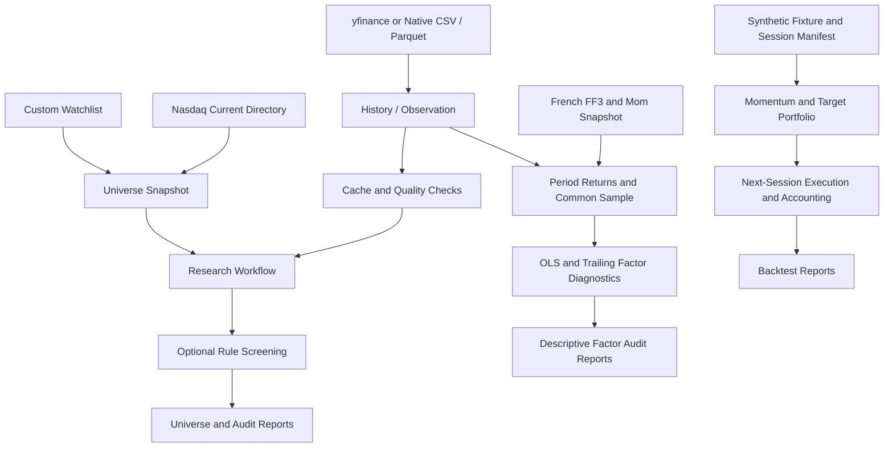

# PortfolioResearchDesk

## Project Overview

PortfolioResearchDesk is a local-first Python platform for equity research,
stock screening, strategy simulation, and portfolio analysis. Its long-term goal
is a reproducible workflow from universe selection to research signals,
portfolio construction, backtesting, and paper portfolio review.

**Development version: 0.6.0. Phase 5 final acceptance passed; merged and synchronized to the private repository.**
Phases 0–3 remain accepted; Phase 4 acceptance covers synthetic USD software validation only.
Phase 3 is accepted for ex-post descriptive factor research after independent
verification of fixes R1–R5. This is not certification of a PIT trading strategy
or OOS performance. Phase 5 adds CAD/USD risk, accounting, reviewed paper plans and recovery.
The system does not connect to brokers or execute real orders.

## Key Features

- **Custom Watchlists:** import/export identity CSVs; save, load, update, and
  deduplicate lists using market, exchange, symbol, and currency.
- **Market Universe:** retrieve the official Nasdaq Trader current listed-security
  directory with source, snapshot time, membership labels, and coverage warnings.
- **Rule-Based Screening:** combine minimum history, liquidity, price momentum,
  and historical volatility rules on custom or market universes; retain each
  inclusion or exclusion reason.
- **Data Adapters:** retrieve US/USD daily observations through yfinance or load
  native CSV/Parquet files with explicit provenance and price conventions.
- **Cache and Quality:** immutable snapshots, SHA-256 checks, SQLite lookup,
  expiry policies, offline replay, bounded retries, and explicit failures.
- **Synthetic Backtesting:** past-only momentum, Top-K equal-weight targets,
  integer shares, next-session execution, fees, slippage, cash, and NAV accounting.
- **Auditable Outputs:** configuration, data/code fingerprints, quality and
  screening reports; JSON/CSV research exports and JSON/CSV/HTML backtest reports.
- **Factor Diagnostics:** US French daily/monthly factors, same-sample FF3/Carhart
  FF4 OLS, classical or HC3 inference, residual/collinearity diagnostics, trailing
  exposures, and JSON/CSV/HTML/SVG/PNG reports.
- **Synthetic ML Validation:** prior/Logistic/Lasso/Random Forest/XGBoost models,
  training-only pipelines, nested date-grouped purged walk-forward tuning, frozen
  final holdout, classification metrics and shared-engine net portfolio comparisons.
- **CAD Paper Accounts:** USD/CAD cash and integer holdings, available historical FX,
  conservative conversion costs, risk limits, pending review plans, atomic simulated
  fills, cash flows, simple splits/dividends, restart replay and idempotent retry.

## Current Development Status

| Area | Status in v0.6.0 development |
|---|---|
| Installable package, CLI, strict TOML configuration | Implemented and locally tested |
| Custom / Market / Screening and combined modes | Implemented and locally tested |
| Real-data retrieval, local adapters, cache, quality | Implemented; live retrieval and cached replay verified locally |
| Execution and portfolio accounting | Validated on synthetic USD/CAD fixtures; real-market execution is not certified |
| Backtesting with real market data | Not enabled; data and execution assumptions need further validation |
| Historical membership and delisted-security coverage | Not available; survivorship bias remains unresolved |
| FF3/FF4, OLS, rolling beta | Accepted for descriptive attribution; R1–R5 independently verified |
| ML and purged walk-forward OOS evaluation | Passed final synthetic USD validation; no real-market PIT/OOS certification |
| CAD/FX, risk and persistent paper portfolios | Accepted for synthetic verification and local paper use; independent review and Ubuntu/Windows CI passed |
| Dashboard and V1.0 release | Planned for Phase 6 |

Phase 3 is committed, merged into `main`, and pushed to the existing private
repository, with its development branch preserved. The
[verified Phase 3 CI](https://github.com/yufeizhang06/PortfolioResearchDesk/actions/runs/40597881595)
passed on Ubuntu and Windows for commit `139d17f`: 330 tests per platform, Ruff,
CLI, build, sdist rebuild, and isolated wheel installation checks. The initial
run exposed a cold-cache installation-check issue; its fix and evidence are
recorded in the acceptance report. No push-triggered run was observed; this
verification used `workflow_dispatch`. Check Actions for later commit results.
The [initial verified CI run](https://github.com/yufeizhang06/PortfolioResearchDesk/actions/runs/40544579916)
passed on both Ubuntu and Windows after the fresh-checkout test configuration fix.

## Architecture Overview

The project uses a modular monolith. CLI commands call reusable services;
screening, portfolio, and execution logic do not depend on a specific provider
or user interface.



Research observations preserve provider precision, unknown event times, and
data availability. They are distinct from executable backtest bars. Real
observations are not routed into the synthetic execution pipeline.

Historical inputs must satisfy `available_at <= decision_at < execution_at`.
Unknown timing or coverage cannot be treated as verified point-in-time (PIT) or
out-of-sample (OOS) evidence. See [Architecture](docs/ARCHITECTURE.md) and
[Data Policy](docs/DATA_POLICY.md).

## Installation

Requirements: **Python 3.12.x** and **uv 0.13.6**. Clone this repository and run
from its root. Initial installation needs network access; offline examples
do not need an API key or market connection.

Windows PowerShell:

```powershell
py -3.12 -m pip install uv==0.13.6
py -3.12 -m uv sync --locked --extra data --extra factors --extra ml --python 3.12
```

macOS / Linux:

```bash
python3.12 -m pip install uv==0.13.6
python3.12 -m uv sync --locked --extra data --extra factors --extra ml --python 3.12
```

Commands below assume `uv` is on PATH. Otherwise use `py -3.12 -m uv` on Windows
or `python3.12 -m uv` on macOS/Linux. No virtual environment activation is needed.
See the [uv installation guide](https://docs.astral.sh/uv/getting-started/installation/)
if your system restricts global tool installation.

The `data` extra installs yfinance and PyArrow, with dependencies fixed in
`uv.lock`. The base package supports synthetic examples and native CSV research
using the standard library. Full adapter tests, live data, and Parquet need the
extra. The `factors` extra installs locked NumPy, SciPy, statsmodels and matplotlib.
With dependencies cached, use `uv sync --locked --extra data --extra factors --offline`.
The `ml` extra adds locked scikit-learn and XGBoost; models run on CPU with one
thread and a fixed seed. Include `--extra ml` for Phase 4 tests and examples.

## Quick Start

Run a new **synthetic 3,000 CAD paper account** (standard library only):

```bash
uv run --locked --offline prd config validate --kind paper --config configs/example_paper.toml
uv run --locked --offline prd paper demo --db outputs/paper/demo.sqlite3 --run-id cad-demo
uv run --locked --offline prd paper status --db outputs/paper/demo.sqlite3
```

Use a new database and report ID for each demo. The demo performs an explicitly
scripted synthetic review; normal proposals stay `PENDING_REVIEW` until an explicit
`paper review --approve --plan-hash ...` precedes `paper simulate`. Simulation is
atomic: an execution gap, missing FX or insufficient cash rejects the whole batch.
Restarting `paper status` reconstructs the ledger; repeating the identical simulation
request cannot fill or charge fees again. See [Paper/CAD guide](docs/PAPER_TRADING.md)
for the manual workflow, native input schema, accounting and operating limits.
Phase 5 functional commit `8904e11` is merged and pushed. Its
[verified CI](https://github.com/yufeizhang06/PortfolioResearchDesk/actions/runs/40759391233)
passed on Ubuntu and Windows, including 609 tests per platform and build/install
checks. It used `workflow_dispatch`; push-triggered execution was not observed.
See [Phase 5 acceptance](docs/PHASE_5_REPORT.md) and Actions for later documentation revisions.

Run the offline **synthetic USD** ML experiment:

```bash
uv run --locked --offline prd config validate --kind ml --config configs/example_ml.toml
uv run --locked --offline prd ml run --config configs/example_ml.toml
```

The report compares all predeclared models, Cash, Buy-and-Hold, Equal-weight and
Momentum. It saves every outer/inner fold, training preprocessing statistics,
OOS prediction, excluded label, target, order, fill, position and NAV in
`outputs/ml/<run_id>/`. Final holdout never tunes parameters or selects a winner.
Lasso predicts continuous price returns; its scores are not probabilities.
These are software validation results, **not real-market trading evidence**.
See [Model validation](docs/MODEL_VALIDATION.md) and [Phase 4 report](docs/PHASE_4_REPORT.md).

Run offline synthetic factor research (96 known-answer observations):

```bash
uv run --locked --offline prd config validate --kind factors --config configs/example_factors.toml
uv run --locked --offline prd research run --config configs/example_factors.toml
```

Open `report.html` in the returned `report_directory`. It includes common-sample
FF3/FF4 estimates, standard errors, t/p values, confidence intervals, R², adjusted
R², AIC/BIC, diagnostics, a beta heatmap and trailing exposure charts. JSON contains
input snapshots, exclusions and every rolling-window result. Alpha is a decimal
return per observation period; no automatic annualized alpha is claimed.

For live **descriptive** AAPL research, review dates and sources, then run:

```bash
uv run --locked --offline prd research run --config configs/example_factors_real.toml
uv run --locked --offline prd research run --config configs/example_factors_real.toml --offline
```

The first command can access French and Yahoo; the second requires their valid
caches. French percent returns are divided by 100 once. Response = stock return
minus same-period RF; `Mkt-RF` is already market excess return. FF4 adds French Mom,
not an individual stock's momentum score. Both models use identical complete cases.
No factors or rolling coefficients enter backtest decisions. See
[Factor methodology and configuration](docs/FACTOR_RESEARCH.md).

Run the packaged, explicitly **synthetic** research workflow:

```bash
uv run --locked --offline prd --help
uv run --locked --offline prd demo
uv run --locked --offline prd universe build
uv run --locked --offline prd data fetch --config configs/example_research_offline.toml
```

Run the synthetic backtest and its hand-checkable accounting scenario:

```bash
uv run --locked --offline prd backtest run --config configs/example_backtest.toml
uv run --locked --offline prd backtest run --config configs/example_handcheck.toml
```

These results validate timing and accounting, not market performance. Backtests
write to `outputs/runs/<run_id>/`; research writes to
`outputs/research/<run_id>/`. Existing runs are never overwritten. A final
`run.json` marks a completed report bundle; inspect its status and warnings.

For real-data descriptive research, review and edit the example date range and
asset list first. The examples use AAPL/MSFT, USD, and
`[2026-10-01, 2026-10-27)`, with an exclusive end date:

```bash
uv run --locked --offline prd data fetch --config configs/example_real_research.toml
uv run --locked --offline prd universe build --config configs/example_market_research.toml
uv run --locked --offline prd universe build --config configs/example_market_research.toml --offline
```

The first two commands may access market sources. **`uv --offline` only prevents
dependency downloads.** The final application-level `--offline` prohibits remote
data requests and requires valid existing cache entries. `--allow-stale` permits
expired entries explicitly and records that choice; `--refresh` requests a new
snapshot. Source failures never trigger a synthetic fallback.

Research configuration uses `schema_version=2`:

| Setting | Behavior |
|---|---|
| `universe.mode="custom"` | Explicit identity tables or a saved watchlist |
| `universe.mode="market"` | Current Nasdaq directory, optional custom additions and include/exclude filters |
| `universe.mode="screening"` | Rules applied to an explicit custom base |
| `screening.enabled=true` | Rules combined with AND; supported for custom and market modes |
| `data.expected_kind` | Required real/synthetic distinction; mixed identities rejected |
| `data.max_assets` | Configurable request budget; exceeding it fails without silent truncation |
| `research.require_point_in_time=true` | Blocks unverified historical membership |

Paths inside research TOML files resolve relative to that file. The
`--config` path itself resolves from the calling directory. Validate explicitly:

```bash
uv run --locked --offline prd config validate --config configs/example_offline.toml
uv run --locked --offline prd config validate --kind backtest --config configs/example_backtest.toml
uv run --locked --offline prd config validate --kind research --config configs/example_real_research.toml
```

Watchlist CSVs require the header `market,exchange,symbol,currency`. After
creating your local input file:

```bash
uv run --locked --offline prd universe watchlist import --input data/my_watchlist.csv --output data/watchlist.json --kind real
uv run --locked --offline prd universe watchlist update --input data/watchlist.json --output data/watchlist.json --add US:XNAS:NVDA:USD --remove AAPL
uv run --locked --offline prd universe watchlist export --input data/watchlist.json --output data/export.csv
```

Use `watchlist="../data/watchlist.json"` in place of `assets` in a configuration
under `configs/`. For native file inspection and conversion, use
`prd data check --help` and `prd data convert --help`. CSV requires its matching
`.metadata.json`; Parquet embeds metadata. Arbitrary vendor CSVs need an explicit
mapping to the native contract first.

CLI results are JSON on stdout; diagnostics use stderr. Expected input errors
exit 2. Multi-asset requests may finish with `status="partial"` and exit 0 when
usable data remains; review failures and quarantined observations.

## Testing

Install the locked environment with the `data`, `factors` and `ml` extras, then run:

```bash
uv lock --check --offline
uv run --locked --offline pytest -q
uv run --locked --offline ruff check .
uv run --locked --offline ruff format --check .
uv run --locked --offline prd config validate --kind research --config configs/example_research_offline.toml
uv run --locked --offline prd config validate --kind factors --config configs/example_factors.toml
uv run --locked --offline prd research run
uv run --locked --offline prd config validate --kind ml --config configs/example_ml.toml
uv run --locked --offline prd ml run
uv run --locked --offline prd config validate --kind paper --config configs/example_paper.toml
uv build --offline --no-build-isolation --out-dir dist/phase5
uv run --locked --offline python scripts/verify_distribution.py dist/phase5 --with-factors --with-ml
```

Phase 2 acceptance recorded **208 passing tests**, including Phase 0–1
regressions. The verified Phase 2 Ubuntu and Windows CI jobs each also passed all 208
tests, lint, CLI, build, and isolated installation checks. Tests use fixed
fixtures and injected transports; pytest-socket
blocks sockets in the test process. Live source checks are separate manual
integration checks, not a dependency of CI.
Pytest uses the platform's default temporary directory; tests do not require a
pre-existing local work directory.

The distribution check rebuilds a wheel from the sdist, installs both wheels in
a clean environment, and runs Phase 0–3 commands outside the source tree when
`--with-factors` is selected. Factor dependencies use the existing lockfile and
offline wheel cache directly; the checker verifies that the installed wheel
remains in the isolated environment. CI
targets Python 3.12 on Ubuntu and Windows. Checkout and dependency installation
need network access; test and example execution is offline. Remote status is
established only by actual GitHub Actions runs.

Phase 3 acceptance, verified remote CI, and limitations are recorded in
[Phase 3 acceptance](docs/PHASE_3_REPORT.md).
The initial Phase 3 suite passed 270 tests; R1–R4 added 28 regression cases.
The R5 fix adds 32 time-alignment cases, bringing the suite to **330 tests**;
all original tests are retained.

Phase 4 final verification and independent review evidence are recorded in
[Phase 4 acceptance](docs/PHASE_4_REPORT.md). Functional commit `05d1900` is merged
and pushed to the existing private repository. Its
[verified Ubuntu/Windows CI](https://github.com/yufeizhang06/PortfolioResearchDesk/actions/runs/40602662692)
passed 425 tests per platform, Ruff, CLI, build, sdist rebuild and both isolated
wheel installations. This run used `workflow_dispatch`; push-triggered execution
was not observed. Later documentation commits require their own CI status.
The local suite passes **425 tests** (the original 330 plus 95 Phase 4 cases).
Independent review found no actionable defects within synthetic USD validation.
Its 3,024 fold checks cover 144 combinations of label horizon 1–12, gap 0/2/10,
safety embargo 0/3, and expanding/100-date rolling windows. They test boundaries,
not 3,024 fitted models or independent market experiments. Additional acceptance
tests perturb outer-validation labels and both holdout features and labels.
All preprocessing is fitted within training folds. Lasso is a return regressor
with L1 shrinkage; the explicit selector is VarianceThreshold. Classifier scores
remain uncalibrated. Repeated synthetic holdout runs validate software and do not
establish an untouched real research holdout.

Phase 5 now passes **609 tests locally** (the original 425 plus 184 new cases),
Ruff, locked dependency checks, sdist rebuild and both isolated wheel installations.
Independent review found actionable edge defects in the initial implementation;
they were fixed and rechecked with regression tests. Final review has no unresolved
actionable P1/P2/P3 findings for the frozen synthetic CAD/USD scope. It separately
ran 214 targeted tests, 1,000 Fraction numerical cases and 24 concurrent retries.
See [Phase 5 acceptance](docs/PHASE_5_REPORT.md) for evidence and limitations.
The final acceptance adds a research-to-paper revaluation and fresh-process recovery
regression. Its 3,000 CAD example executes three fills, marks NAV from 2,994.48 CAD
to 2,949.10 CAD under explicit synthetic price/FX changes, and restores the complete
account exactly. These are software checks, not market performance evidence.

## Project Structure

```text
src/portfolio_research_desk/
    cli.py, data_cli.py                  CLI boundaries
    config.py, backtest_config.py,
    research_config.py                  Strict configuration schemas
    domain.py, data_contracts.py         Shared types and quality validation
    data_adapters.py, data_cache.py      External/local data and snapshots
    universe.py, screening.py           Universe management and rules
    market_data.py, signals.py,
    portfolio.py, execution.py,
    backtest.py                         Synthetic simulation pipeline
    research_workflow.py, reporting.py   Orchestration and audit output
    factor_data.py, factor_returns.py    French snapshots, returns and alignment
    factor_analysis.py                  OLS, diagnostics and trailing windows
    factor_config.py, factor_cli.py,
    factor_workflow.py,
    factor_reporting.py                 Factor service, CLI and audit reports
    ml_data.py, ml_validation.py         Features, labels and purged global-date folds
    ml_models.py, ml_workflow.py         Fold-local pipelines and nested experiments
    ml_config.py, ml_cli.py,
    ml_reporting.py                     ML configuration, CLI and audit reports
    fx.py, portfolio_risk.py             Available FX, CAD valuation and constraints
    paper_domain.py, rebalancing.py,
    paper_execution.py                  CAD contracts, shared planner and pure simulation
    paper_store.py                      Atomic SQLite events, replay and idempotence
    paper_config.py, paper_cli.py,
    paper_reporting.py, paper_sample.py  Paper services, CLI, fixtures and exports
    resources/                          Fixed synthetic data and defaults
configs/                                Editable Phase 0–5 TOML examples
tests/                                  Offline unit/integration/regression tests
scripts/                                Distribution verification
docs/                                   Plan, architecture, policy, acceptance logs
.github/workflows/                      CI
```

Local `data/`, `outputs/`, `work/`, virtual environments, credentials, and build
artifacts are excluded from Git. Downloaded real market data is not distributed.

## Data Sources & Limitations

- **Yahoo via yfinance:** a third-party research interface, not an exchange's
  official market data API. Availability, history revisions, delisted securities,
  and redistribution rights are not guaranteed. Review the
  [yfinance documentation](https://ranaroussi.github.io/yfinance/) and applicable
  Yahoo terms before use; raw downloads remain local.
- **Nasdaq Trader:** the [official current directory](https://www.nasdaqtrader.com/dynamic/SymDir/nasdaqlisted.txt)
  is a current listed-security snapshot, not Nasdaq-100, S&P 500, or historical
  membership. ETF/test/NextShares records are excluded, but some warrants and
  other non-common-stock securities remain.
- **Survivorship and identity history:** historical index members, complete
  delisted coverage, mergers, and renaming maps are unavailable. Survivorship
  bias is unresolved. Current membership cannot be presented as historical PIT.
- **Time availability:** Yahoo daily `event_time` is unknown.
  `observation_end` is an explicitly labelled local-date upper bound;
  `available_at` is actual retrieval time. Historical publication times are not
  invented. Known events must match the supported exchange's local session date.
  Contradictory time labels are quarantined and factor research rejects them
  before regression. Unknown event/source/timezone evidence is explicitly marked
  descriptive-only and ineligible for strict historical use. Late downloading
  of a correctly dated historical snapshot remains supported.
- **Prices and corporate actions:** automatic adjustment, back adjustment, and
  repair are disabled. Provider OHLC, adjusted close, dividends, and splits are
  stored separately. This does not prove historical tradable raw prices.
  Screening windows with corporate actions require review.
- **Research scope:** authoritative exchange calendars, complete real-market
  corporate-action entitlement accounting and real-data execution validation are not provided yet. The Phase 4
  OOS framework is exercised on synthetic data only. Real observations remain descriptive inputs, separate
  from the validated synthetic backtest. No strategy returns or model performance
  are claimed from these examples.
- **Screening conventions:** dollar volume approximates mean `close * volume`;
  volatility is the sample standard deviation of simple daily returns multiplied
  by `sqrt(252)`. These are assumptions, not trade-level turnover or a verified
  exchange calendar.
- **Factor attribution:** current French history is a retrieved, possibly revised
  vintage, not verified historical publication information. Adjusted-close ratios
  are a provider total-return proxy. Plain-close research excludes dividends and
  refuses action periods. Monthly returns require an explicit session calendar
  including the prior month; missing endpoints are never silently substituted.
  Price/session conflicts are rejected. Monthly rolling windows retain completely
  missing calendar months. Declared provider-adjusted Close cannot be labelled as
  price-only returns. French normalization is independent of Decimal context;
  its v2 factor cache requires one new online fetch before offline replay.

See [Data Policy](docs/DATA_POLICY.md),
[Backtest Assumptions](docs/BACKTEST_ASSUMPTIONS.md), and
[Phase 2 Acceptance](docs/PHASE_2_REPORT.md) for detailed boundaries and actual
local integration evidence.

## Development Roadmap

| Phase | Scope | State |
|---|---|---|
| 0 | Packaging, configuration, fixtures, engineering checks | Completed locally |
| 1 | Synthetic universe-to-execution vertical slice | Completed locally |
| 2 | Real-data research adapters, cache, universe modes, screening | Completed locally |
| 3 | Kenneth French factors, FF3/FF4, OLS, rolling beta | Accepted for ex-post descriptive research |
| 4 | Baselines, ML, purged time-series validation, OOS comparison | Accepted for synthetic USD software validation; independent review and dual-platform CI passed |
| 5 | Portfolio risk, historical FX/CAD, persistent paper accounts | Accepted for synthetic CAD/USD and local paper software; independent review and dual-platform CI passed |
| 6 | Dashboard, documentation, product validation, V1.0 release | Planned |

`main` holds Phases 0–5; `phase-2-data-universe` retains Phase 2
history, and `codex/phase-3-factor-diagnostics` retains Phase 3 history.
Phase 4 commit `05d1900` was fast-forwarded to `main` and both branches were pushed
to the existing private repository. The Phase 4 branch is retained; actual CI
evidence is recorded in its acceptance report.
Future phases use separate feature branches and require
explicit acceptance. The initial GitHub upload is a development checkpoint,
not a V1.0 release.

Phase 5 was developed on retained branch `codex/phase-5-cad-paper` from verified
`main` commit `0e4ca96`. Functional commit `8904e11` was fast-forwarded into `main`
and both branches were pushed without rewriting history. It preserves the legacy USD engines and uses the shared CAD planner
and simulator in an explicitly synthetic CAD history harness. Real observations
can be supplied with forward-paper provenance and availability checks; this does
not certify their historical PIT suitability. The Phase 3 descriptive boundary
remains enforced. [Phase 5 acceptance](docs/PHASE_5_REPORT.md) records actual local
checks and review evidence. Phase 6 has not started.

The original [Project Plan](docs/PROJECT_PLAN.md) is preserved. Read the
[Development Log](docs/DEVELOPMENT_LOG.md), [Changelog](docs/CHANGELOG.md), and
[AGENTS.md](AGENTS.md) before making changes. Detailed project documentation is
currently maintained in Chinese; code identifiers and this README use English.
