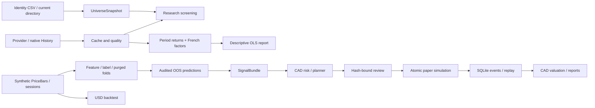

# Architecture & Code Walkthrough

Read this beside the source and tests. The code is a modular monolith: services
compose pure calculations; adapters and reports own I/O. CLI modules register
arguments and translate project errors to exit 2 / stderr. No UI, provider or
broker dependency enters portfolio/accounting calculations.

## Data flow and evidence boundaries



`History/Observation` can preserve unknown event times and provider decimals.
`PriceBar/Quote` is a stricter executable contract. They are not interchangeable.
Current membership is not historical membership. Factor diagnostics do not feed
trades. The Phase 6 demo shares its short price fixture across momentum, USD
backtest and CAD planning; optional factors/ML retain separate fixtures and scopes.

## Suggested reading order

| Step | Modules | What to learn / test |
|---|---|---|
| 1 | `domain`, `errors`, `config`, `cli` | Immutable identities/time contracts; thin CLI and error boundary |
| 2 | `market_data`, `signals`, `portfolio` | Explicit sessions, past momentum, deterministic ties, integer target requests |
| 3 | `execution`, `backtest`, `reporting` | Next-open scheduling, fees, cash/risk checks, NAV and immutable exports |
| 4 | `data_contracts`, `data_adapters`, `data_cache` | Provider precision/provenance, native round trips, bounded network edge, cache hashes |
| 5 | `universe`, `screening`, `research_workflow` | Custom/current membership, AND filters, explainable exclusions |
| 6 | `factor_data`, `factor_analysis`, `factor_workflow` | Unit conversion, RF, common sample, OLS and trailing windows |
| 7 | `ml_data`, `ml_validation`, `ml_models`, `ml_workflow` | Feature/label clocks, purge, train-only fit, nested tuning and frozen holdout |
| 8 | `paper_domain`, `fx`, `paper_execution`, `portfolio_risk` | Decimal accounting, FX direction, cash versus valuation, limits |
| 9 | `rebalancing`, `paper_execution`, `paper_store` | Target-to-order reasoning, review/replay/transaction boundary |
| 10 | `paper_inputs`, `paper_services`, `product_workflow`, `delivery_reports` | Readable transport, reusable product service and completion/integrity boundaries |

Use `rg --files src tests` to find the exact paths; every module lives under
`src/portfolio_research_desk/`. Existing detailed contracts are in
[DATA_POLICY](DATA_POLICY.md), [FACTOR_RESEARCH](FACTOR_RESEARCH.md),
[MODEL_VALIDATION](MODEL_VALIDATION.md), [PAPER_TRADING](PAPER_TRADING.md) and
[BACKTEST_ASSUMPTIONS](BACKTEST_ASSUMPTIONS.md). Those explain supported algorithms
and exceptions; this document is the connecting map.

## Key algorithms and accounting

**Past momentum and targets.** Score a trailing window using prices already
available at the decision. Sort deterministically; choose Top-K and cap position,
sector and cash exposure. Explicit target weights are also supported. Integer
shares, fees and conservative sizing can leave unused cash; the planner records
reasons. It is a transparent feasible heuristic, not a global optimizer or a
promise to attain every target exactly. At execution, recompute feasibility
against the actual next open and FX; an infeasible batch rejects atomically.

**Time sequence.** `available_at <= decision_at < execution_at`. A close used for
a signal cannot fill that order at the same close. The session manifest, not an
assumed weekday calendar, selects the next execution. Unknown real membership,
actions or timing cannot be turned into synthetic-grade PIT evidence by changing
a flag. The readable input layer rejects future reference quotes; deeper services
select only available FX/sectors and enforce quote/FX age limits.

**Factor regression.** For each common complete period, use
`y = stock_return - RF` and `X = [1, Mkt-RF, SMB, HML, (Mom)]`. Convert French
percent units once. Fit FF3 and FF4 on the same rows for comparison. Classical/HC3
uncertainty and residual/collinearity diagnostics are descriptive; trailing fits
use only each window's data. Month-end endpoints and nominal-window gaps matter.
These coefficients are not available historical alpha signals by default.

**ML.** Features use earlier bars; labels retain start/end/known times. Split by
global session dates, purge overlapping or unknown labels at boundaries, and fit
preprocessing only on training rows. Inner folds choose hyperparameters; development
folds freeze a model before the final holdout. Compare declared models and simple
benchmarks under shared execution costs. No random row split and no holdout winner
selection. Fixed seeds aid reproducibility; they do not establish real OOS skill.

**CAD NAV.** If `r` is available CAD per USD:

```text
NAV_CAD = cash_CAD + cash_USD * r
          + sum(CAD shares * raw CAD price)
          + sum(USD shares * raw USD price * r)
```

A buy reduces cash by notional plus commission, with slippage in the fill price.
If USD is insufficient, convert CAD with an explicit fee and conservative cent
rounding. Sell proceeds/realized cost basis follow the same ledger. Cumulative
commission/FX/slippage are attribution fields, **not extra NAV deductions**.
Raw prices plus supplied actions avoid counting dividends/splits twice. CAD
cost-basis P&L is not a tax ledger or a cash-flow-adjusted performance metric.
Public CAD calculations isolate a 50-digit Decimal context from callers.
Independent Fraction/hand-derived test calculations check these identities.

**Events and recovery.** Commands store canonical typed inputs, previous/head
hashes, sequence and result fingerprints under a SQLite transaction. Load replays
and checks the result. A repeated identical idempotency key returns the stored
outcome; a changed payload under that key fails. Review binds to the proposed plan
hash. Simulation is atomic; errors cannot leave half a portfolio or repeated fees.
SQLite is a trusted local audit store, not an encrypted or tamper-proof remote
ledger. Back up closed files; do not edit tables to recover an account.

## Phase 6 service map

- `workspace.create_workspace`: exclusively creates packaged configs and readable
  synthetic snapshots. It works without repository files after wheel installation.
- `diagnostics.inspect_environment`: cheap metadata checks; execution preflight
  separately imports requested scientific libraries before making a run directory.
- `workflow_config`: schema 6 orchestration only; old phase-specific schemas remain.
- `paper_inputs.parse_paper_input`: ordinary JSON to immutable Phase 5 contracts.
  Decimal strings, explicit UTC, exact fields and raw prices; no new ledger math.
- `paper_services`: compact plans, snapshot-driven operations, recorded-NAV freshness
  based on event order (same-timestamp cash events still make an old mark stale).
- `product_workflow.run_workflow`: orchestrates public services, scripted review only
  for synthetic demo, retry/reload assertions, optional diagnostics and pending ML
  preview. A factor failure or unavailable extra cannot become a completed run.
- `delivery_reports`: reserves immutable paths, rejects unsafe IDs/symlinks, hashes
  all artifacts and verifies confinement. Writes `workflow.json` after all output.
  Hashes detect accidental changes but do not authenticate a rewritten manifest.
- `product_cli` / `paper_cli`: user arguments only. The old native schema 5 transport
  remains supported; readable schema 6 is additive, with purpose-specific snapshots.

## Design decisions and extending safely

No Streamlit is added: CLI services and self-contained HTML already cover this
local workload. A future UI should call the same services and explicitly model
review/idempotency, never hold an account's financial truth in UI session state.
No new optimizer/model/provider dependency is necessary for Phase 6.

To add a provider, implement the existing History adapter and preserve provenance;
do not bypass time/currency/identity contracts. To add a signal, return a validated
SignalBundle and declare its evidence scope; do not reuse labels or ex-post factors
as known-at-decision inputs. To add an economic event, design replay, cent rounding,
NAV identity and crash/retry tests before adding CLI flags. A future change in
persisted schema needs a deliberate migration policy, not an ignored version check.

For study, run a base workflow, match one order in `review-plan.json` to
`paper/account/trades.csv`, recompute its cash impact, then change only the closing
FX in an independent fixture. Read `test_product_workflow.py`'s Fraction NAV check
and `test_product_cli.py`'s manual lifecycle. Next read the Phase 5 golden/boundary
accounting tests and Phase 4 future-perturbation tests. Keep such experiments under
`work/` and avoid editing an accepted immutable report bundle.
