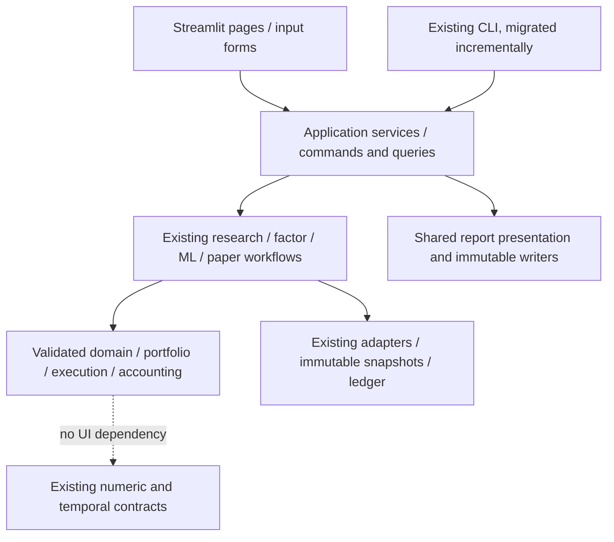

# Phase 7 — 本地 Dashboard 页面与架构方案

2026-10-29 · **设计方案已获用户批准；首版实现状态见 PHASE_7_REPORT 与 GUI_GUIDE。**

下文保留原批准方案，不代表六页全部功能已交付。本轮只实现 Home、自选股/行情、Factor
首个闭环，另提供只读 Paper 与本轮报告入口；ML/回测表单、筛选器、Paper 写入向导延后。
原“待确认/尚未实现”段落是方案提交时的历史状态。

本轮 Task 1 已将 CAD Paper 的视觉标准扩展到 Factor、ML 和 Backtesting。
Task 2 的交付是本方案。没有添加 Streamlit 依赖、启动服务、修改账户、连接券商或发布产品。
后续实现须经用户确认；下文的页面、接口和验收门槛均为计划，不是已交付能力。

## 1. 产品原则与共同页面结构

面向普通个人研究者：输入代码、选择日期及参数、点击运行、查看解释与图表、导出报告。
TOML、JSON、SQLite、哈希及命令行放在高级审计入口，不成为完成主流程的必要操作。
数据种类、币种、时间和已知限制则始终可见，不能为了简洁而隐藏。

采用已通过报告验收的深蓝标题、青色强调、浅灰表格、留白和等宽数字。
颜色之外保留文字状态；损失、错误、缺失不能仅靠红绿区分。
桌面主区依次为页面标题与数据身份、最多四张核心卡片、主要操作、明细、方法与下载。
窄屏卡片变两列、表格在局部横向滚动；整页不横向溢出。
在线查看和打印共用报告数据及格式化规则，打印采用已完成的自包含 HTML。
视觉与数字规则见 [REPORT_DESIGN_STANDARD.md](REPORT_DESIGN_STANDARD.md)。

应用壳包含六个页面入口、当前工作区、当前账户、数据模式及最近一次成功刷新时间。
状态统一为“尚无数据 / 正在运行 / 已完成 / 部分结果 / 失败 / 结果已过期”；失败保留原因和上一次有效结果，
但把旧结果标为历史。切换工作区或账户后，不沿用另一个账户的指标、输入草稿或审核状态。

## 2. 六个页面及主要操作

### Home Dashboard

- 首次使用：选择本地工作区或“创建工作区”，运行只读环境诊断；缺少可选组件只阻断相应模块。
- 首屏：最近有效 CAD NAV、现金、持仓市值、待审核计划数。没有估值时显示“尚未估值”；
  经济事件发生在估值之后时显示“需要重新估值”，不把历史 NAV 包装成当前值。
- 快捷入口：“管理自选股”“运行因子研究”“打开模型实验”“查看 Paper 账户”“查看报告”。
- 最近任务列表：类型、数据模式、生成时间、状态和“打开结果”，不按最高收益自动排序。
- 单独的“运行合成示例”入口先说明 3,000 CAD、独立 USD 回测和 ML fixture；
  示例使用新账户/新目录，不写入用户已有账户，不把几个不同样本的收益合并。
- 验收：空工作区可自助进入示例；重启后能打开同一已保存结果；CAD 与 USD 卡片不混算。

### Stock Explorer & Watchlists

- 用户输入 `AAPL, MSFT` 等代码，逐行确认市场、交易所和币种；显示名称仅使用有来源的元数据。
  不猜测证券身份，也不把同代码不同市场合并。
- 创建/重命名/保存自选列表；批量粘贴、CSV 导入和 CSV 导出。导入先预览错误行、重复项和新增/移除差异。
- 行情表单：日期范围、数据来源、价格口径、是否刷新。首次允许显式获取网络数据；
  失败时提供重试或使用带日期的缓存，不静默切换成合成数据。
- 结果：价格曲线、覆盖区间、缺失/隔离条数、来源及可得时间。描述性筛选显示入选和排除理由。
- 当前 Nasdaq 目录标为“当前目录快照”；不能改名为 Nasdaq-100、历史指数成分或 PIT 股票池。
- “加入因子研究”传递证券及快照引用；“进入真实池回测”在当前后端下不可用，并解释缺少什么能力。
- 验收：保存/重载身份完全一致；刷新创建新快照；未知证券、缺失元数据和过期缓存都有可恢复提示。

### Research & Factor Analysis

- 从自选股选一只证券，设置起止时间、日/月频、FF3/FF4、价格基础、经典/HC3 协方差、
  置信水平、滚动窗口；输入使用单位与范围提示，默认值来自已有配置契约。
- 点击“检查输入”查看共同样本、来源、数据可得性和运行范围，再点击“运行因子研究”。
- Overview：Alpha（每个观察期）、Market Beta、R²、共同样本数。Details：FF3/FF4 比较、
  滚动暴露、区间/p 值、残差/共线性诊断。Methodology：数据口径、警告、原始下载。
- 用通俗说明解释 Alpha 和显著性；不能把显著 Alpha 直接转成买入建议。
  样本不足/奇异窗口显示失败及原因，不能隐藏失败窗口或填造曲线。
- 真实数据仅允许已经支持的事后描述性研究；该页面不产出历史可交易因子信号。
- 验收：页面与同输入 CLI 报告逐项一致；日/月单位正确；同样本 FF3/FF4 比较及失败分支均覆盖。

### ML & Backtesting

- 两个清晰分区：“模型实验”和“USD 合成回测”，进入时即显示当前支持范围。
- 模型表单：内置合成数据、预声明模型、训练/验证/留出长度、预测跨度、gap/embargo、
  Top-K 和费用。高级选项收纳超参数；不让用户随意关闭时间隔离或选择随机打散。
- 运行前展示数据范围、试验设置和预计工作量，不承诺精确剩余时间。
- 模型结果复用本轮报告：开发期与最终留出期分开，突出开发期冻结选择；
  所有模型、基准、排除标签、失效指标和降级原因保留。不得按留出期成绩自动选优。
- 回测表单使用现有合成数据与既有约束。展示 NAV、累计收益、回撤、现金基准、交易和费用；
  当前引擎没有的年化/Sharpe 指标显示原因，GUI 不补写一套新计算。
- 可打开 ML→Paper 的**待审核**提案；必须明确其合成身份、样本范围及独立账户。
  不能从“运行实验”连带审核或执行。
- 任意真实股票池的自动历史回测、可信真实 OOS 和真实 ML 部署保持不可用。
- 验收：输入变更不触发自动重训；按钮重复触发不会生成重复任务；页面与已保存报告一致。

### Portfolio & Paper Trading

- 默认显示账户货币 CAD、Paper 标识、账户名、估值时间和输入可得时间。
  账户区复用已验收的 NAV、现金、配置、持仓、交易、风险与方法结构。
- 新计划向导：选择证券与目标权重 → 输入/选择有来源的价格、FX、行业及会话时间 →
  检查输入 → 查看模拟订单、预计费用、整数股、现金及风险 → 明确审核该版计划 →
  在合法执行时点输入执行快照 → 点击“模拟成交”。
- 价格/FX 输入使用带单位表格和日期时间控件，普通用户不编辑 JSON。
  必填的来源/观察/可得/决策/执行时间不能悄悄补成系统当前时刻。
- 审核页用普通文字展示持仓变化和约束；计划哈希藏于审计详情，但审核仍绑定准确哈希。
  计划、价格或账户变化后必须重新校验；不能沿用过期审核。
- “重新估值”“记录现金流”“记录换汇”“登记已支持公司行为”各自为独立表单；
  写入前显示明确摘要和模拟身份，成功后从账本重读，不在界面里手工加减余额。
- 首个 GUI 迭代可先交付只读账户与估值，再单独验收提案/审核/执行向导；
  不用一轮庞大界面改造替代关键账本流程的验收。
- 验收：重复点击/浏览器刷新/进程重启不重复成交；拒绝过期计划、未来可得数据、超限操作；
  既有同时间经济事件后的过期 NAV 提示仍有效。

### Reports & Settings

- 报告库按类型、日期、数据模式、账户/证券、状态筛选；条目显示生成时间和样本/估值时间。
- “打开报告”“打印 / 保存 PDF”“下载审计文件”“检查完整性”；未完成/损坏报告可查看错误，
  不能标为已验证。重新设计旧报告必须生成新展示目录，保存原来源和独立展示清单。
- 设置使用表单：工作区、默认日期/时区显示、数据刷新偏好、网络数据来源、显示精度和可选组件状态。
  显示精度只影响视图；财务参数属于新运行输入，不改历史报告或现有账户记录。
- 原始导出单独区域，非默认正文。用户不需浏览 SQLite，支持通过 UI 选择本地备份/导出位置。
- PDF 初版通过已有 HTML 的浏览器 A4 打印；一键后台生成 PDF 是单独可选增强，
  不把本轮验收用 Playwright/Chrome 路径作为产品运行依赖。
- 验收：所有链接可用；完整性失败明确可见；离线报告不依赖外部字体、脚本或行情服务。

## 3. Application Service Layer

目标为模块化单体，调用方向固定：

计划只增加少量 `app_services.py`、`app_contracts.py` 和 `gui/` 页面模块；
命名可在实现时细化，不预建空目录、REST 服务、ORM、消息队列或重复领域模型。
Service Layer 负责用例编排、输入验证、工作区路径约束、能力检查、结果状态及报告引用。
收益、NAV、模型拟合、交易费用、仓位限制与时间正确性仍由已有后端负责。

| 拟议服务操作 | 用户输入 / 返回 | 已有后端落点 |
|---|---|---|
| `inspect_workspace`, `create_workspace` | 工作区选择 → 状态、可用模块、最近运行 | `diagnostics.inspect_environment`, `workspace.create_workspace` |
| `save_watchlist`, `fetch_history`, `screen_watchlist` | 证券身份、日期、来源、规则 → 列表/快照/质量结果 | `universe`、`research_workflow.run_research/save_research_run` |
| `run_factor_study` | 表单参数 + 快照引用 → 研究结果、报告引用、限制 | `FactorConfig`、`run_factor_research`、`save_factor_report` |
| `run_model_experiment` | 合成数据引用 + `MLConfig` → 冻结方案、验证与报告 | `run_ml_experiment`、`save_ml_report` |
| `run_backtest_study` | `BacktestConfig` + 合法数据 → 结果与报告 | `run_backtest`、`write_report` |
| `read_account`, `propose_plan`, `review_plan`, `simulate_plan` | 账户引用、严格输入、预期版本 → 账户/计划摘要 | `paper_services.account_summary/plan_summary`、`PaperAccount` |
| `record_valuation`, `record_cash_flow`, `record_fx`, `record_action` | 有单位/来源/时间的命令 → 最新账本摘要 | `parse_paper_input`、现有 Paper 命令和原子账本操作 |
| `list_reports`, `verify_report`, `export_report` | 工作区内运行引用 → 类型、状态、已验证文件 | 现有报告 writers、`verify_workflow_report`；新增轻量索引只读发现 |

接口使用 Python dataclass/现有配置对象，金额使用 Decimal、日期时间使用带时区对象；
GUI 输入字符串进入服务边界一次转换，不能先转 float 再算钱。
返回值包含明确状态、显示数据、问题列表、`ReportRef`/快照引用，不返回需要用户解读的大段 JSON。
问题列表区分字段错误、数据不可用、研究失败和系统错误，提供普通文字及审计详情。

已核实 `paper_inputs.parse_paper_input(document, expected_purpose)` 可以直接验证表单构造的结构；
不需要先把临时 JSON 写盘再读，也不需要复制验证器。
现有 `propose_from_snapshot` 等文件入口可逐步转为调用共用的 typed service；
CLI 的 JSON stdout、错误退出 2、旧配置 schema 和行为必须保持兼容。
GUI 不调用 CLI 子进程来串联金融流程，不直接 SQL 改账。

## 4. 状态、任务、缓存与写入

推荐入口集中建立 `st.Page` / `st.navigation`，页面函数只取表单和展示结果。
这是官方推荐的多页组织方式；实现时仍需按项目 Python/依赖锁实际验证兼容性。
[Streamlit 多页文档](https://docs.streamlit.io/develop/concepts/multipage-apps/page-and-navigation)

研究参数放入 `st.form`，仅提交后启动计算，避免每次改控件就重新拟合。
界面保留当前任务 ID；重复提交同一命令显示已有运行，用户显式选择“新实验”才创建新 ID。
[Streamlit 表单文档](https://docs.streamlit.io/develop/concepts/architecture/forms)

会话状态仅保存页面选择和未提交草稿；完成结果、计划、审核和账本以已有持久化文件为准。
初版一次只执行一个写操作；耗时实验可先同步运行并显示真实阶段。后台任务/取消为后续独立范围，
不得把尚未实现的中断能力做成可点击按钮。中断或崩溃保留未完成目录，完成标记仍最后写入。

缓存只适用于只读解析及不可变快照，缓存键包含工作区、快照内容哈希、数据模式、参数和代码版本。
账户摘要每次动作后重读并按账本 head 失效，不缓存审核/成交副作用；不把 SQLite 写连接放进共享资源缓存。
Streamlit 数据缓存与共享资源缓存语义不同，后者还涉及线程安全，因此不能用它隐藏业务状态。
[Streamlit 缓存文档](https://docs.streamlit.io/develop/concepts/architecture/caching)

每个账户写命令携带唯一 event/command ID、预期账本 head 和必要的计划 hash。
服务不能把“先检查，再无条件写入”当作并发保证：提交时仍须在账本事务内校验预期版本。
如果现有存储接口不能原子接受该条件，需在 GUI 写入阶段单独提出最小存储接口扩展及并发测试，
不改变记账计算。跨标签页、CLI 并发冲突返回“账户已变化，请重新查看”，不能覆盖更新。
重复执行继续使用已有幂等机制，不通过在界面禁用按钮来替代账本保证。

## 5. 能力与边界必须由服务声明

| 能力 | 初版 GUI 允许范围 | 用户看到的边界 |
|---|---|---|
| 自选列表、行情和筛选 | 现有适配器和有身份的快照 | 当前目录不等于历史 PIT 池；来源和可得时点可见 |
| Factor | 合成或已有真实数据的事后归因 | 统计显著性不等于可交易 Alpha |
| ML / 历史回测 | 已验证合成 USD 流程 | 真实池自动回测和可信真实 OOS 未支持 |
| CAD Paper | 现有输入契约、风险限制和人工审核 | 纯模拟、无券商；未知价格/FX/时间不能补造 |
| 报告与打印 | 既有完整报告与可审计的新展示 | 生成时间不等于样本、估值或数据可得时间 |

能力开关由服务返回，不能仅在 UI 隐藏按钮。真实研究、合成演示及不同币种结果用不同身份保存；
任何跨模块交接验证 data kind、时间和样本，不默许因子回归、ML 和 CAD 演示属于同一个投资实验。

## 6. 无命令行的用户工作流

1. **首次启动**：双击本地启动器 → 选择工作区 → 环境检查 → 打开示例或已有报告。
   启动器计划调用固定入口，用户输入不拼成 shell 命令；只监听本机。
   首次安装与可选依赖作为一次性设置流程，失败提示可理解，不要求用户编辑配置。
2. **普通股票研究**：输入证券 → 确认身份 → 加入自选 → 选择来源/日期并获取数据 →
   查看质量 → 运行 Factor → 先读概览 → 按需看诊断 → 打印/导出。
3. **模型学习实验**：选择合成模板 → 修改合法参数 → 提交 → 查看开发期/留出期 →
   对照基准与成本 → 保存报告。结果不提供“最佳盈利模型”按钮。
4. **日常 Paper**：打开账户 → 查看估值状态 → 准备/验证快照 → 查看提案 →
   审核确定版本 → 合法时点模拟成交 → 重新读账户与报告。取消审核不会产生交易。
5. **以后再打开**：按账户/证券找最近报告 → 校验 → 继续研究或创建新实验；
   不覆盖既有运行，也不要求手工维护数据库。

## 7. 建议实施顺序与验收门槛

| 阶段 | 范围 | 进入下一步之前的证据 |
|---|---|---|
| A：服务边界 | 少量应用服务、能力矩阵、命令/查询契约；CLI 逐步复用 | 同输入服务与旧 CLI 的财务/审计结果一致；原有测试继续通过 |
| B：只读桌面 | 启动器、六页导航、Home、已有报告、只读 Paper 与环境状态 | 空/成功/失败/过期状态，鼠标完成报告查看和打印；实际既有输出验收 |
| C：研究表单 | Watchlists、数据、Factor、合成 ML/Backtest | 无手改配置的真实离线闭环；模型/数据边界、重试和重复提交测试 |
| D：Paper 操作 | 估值、提案、审核、模拟执行及现金/FX/受限公司行为 | 原子版本检查、幂等、重启、拒绝分支和账本对账；用户亲自体验 |

每步都使用真实后端和现有合成账户，不以静态 Mock 截图代替闭环。
服务测试验证参数映射、模式隔离、时序拒绝、金额精度、路径约束与 CLI 一致性。
UI 层采用 Streamlit AppTest 覆盖输入/提交/错误状态，再用浏览器检查实际布局、导航、下载和打印；
AppTest 不能代替 PDF/浏览器视觉验收。
[Streamlit AppTest 文档](https://docs.streamlit.io/develop/api-reference/app-testing/st.testing.v1.apptest)

拟增加独立可选 `gui` extra，届时验证 Python 3.12、现有 scientific extras 与锁兼容，
基础 CLI 安装保持可用。每一步均需质量检查、构建与安装回归；发布/同步仍需另行授权。
本轮停在 Task 1 的报告交付与本方案，等待用户确定 GUI 首个实施范围。
