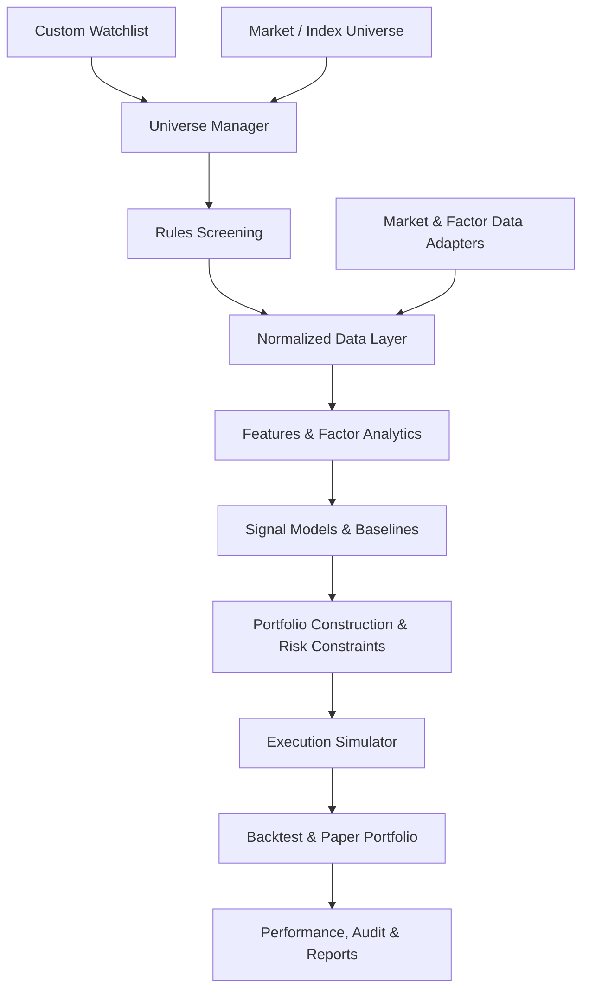

# PortfolioResearchDesk — 项目计划书

> **英文定位**：An end-to-end equity research, strategy backtesting, and portfolio management platform.  
> **项目状态**：规划稿 v1.0（2026-10-26）  
> **目标读者**：项目开发者、OpenAI Codex、GitHub 访客  
> **开发语言**：Python；说明文档中文、代码标识符/注释可优先英文  
> **运行方式**：本地优先（CLI + 可选 Streamlit 界面）；不自动连接券商下单  
> **首发市场**：美国股票；加拿大股票及中国 A 股采用插件式市场适配器逐步扩展  
> **目标记账货币**：CAD；首个最小端到端演示允许 USD 基准，进入 V1.0 前须完成 CAD 历史汇率与换汇成本支持  
> **初始模拟资本默认值**：3,000 CAD（纯示例，可修改）

---

## 0. 一页摘要（Executive Summary）

PortfolioResearchDesk 是面向个人量化研究者的**股票研究—选股—构建组合—回测—虚拟盘—调仓**一体化工具。用户既可以自选任意数量的股票，也可以选择市场/指数股票池，并在两者基础上添加规则筛选。平台通过传统因子研究和可验证的机器学习信号辅助形成候选股票，结合资金与风险限制生成目标持仓，最后通过严格样本外回测及 Paper Trading 检验策略。

**唯一的主工作流：**

`Universe → Market Data → Features & Factor Research → Signals → Portfolio Weights → Execution Simulation → Risk & Performance → Report / Paper Portfolio`

本项目的价值不在于宣传预测准确率或承诺超额收益，而在于：

1. **可解释**：知道股票为何入选、为何分配某一仓位，因子/模型/风险如何影响决策。
2. **时间正确**：任何历史决策不得使用决策时点尚未获得的信息。
3. **可执行**：考虑交易时点、现金、整数股、费用、换汇和持仓约束；不只是理论权重。
4. **可复现**：固定数据快照、配置、随机种子和代码版本可以重现同一实验。
5. **可扩展**：先实现美国股票市场的可靠完整闭环，然后增加市场、策略、模型和界面。

### 不变的产品决策

- 同一产品同时支持 **Custom Watchlist / Market or Index Universe / Rule-Based Screening**，而且三种功能可组合使用。
- 最终结果不止股票分析和评分，而是**目标投资组合、模拟交易和下一次调仓计划**。
- **Long-only、无杠杆、人工审核、模拟交易优先**；V1.0 不集成真实券商下单。
- CLI 是可依赖的核心入口；图形界面只调用同一服务层，不复制研究逻辑。
- 因子分析、机器学习与回测可以分别启用；某一个模型无法运行时，不应阻断其他有效研究工作流。
- 使用简单透明的策略作为基准；复杂模型只有在样本外证据充分时才被采用。

---

## 1. PRD：产品需求文档

### 1.1 用户画像与使用场景

**目标用户**：正在学习统计、数学、经济学与 Python 的个人投资研究者；希望维护虚拟投资组合、研究美国股票并将结果整理成 GitHub 技术项目。

**典型使用场景**：

| 场景 | 输入 | 预期输出 |
|---|---|---|
| 自选研究 | `AAPL, MSFT, NVDA` + 日期区间 | 数据质量报告、因子暴露、研究特征与信号 |
| 指数研究 | S&P 500 / NASDAQ-100 + 日期 | 可追溯成分股研究范围，或清晰标明仅为当前成分股快照 |
| 条件筛选 | 美国市场 + 成交额/动量/波动率条件 | 筛选后的股票池、每只股票入选/剔除理由 |
| 组合构建 | 股票池 + 打分 + 风险规则 | 目标权重、现金比例、集中度指标 |
| 策略回测 | 历史范围 + 再平衡规则 | 净值、回撤、波动率、换手、费用、基准对比 |
| 虚拟账户 | 账户现金、持股、最新合法可用数据 | 新旧权重、模拟订单、执行后预计持仓 |
| 实验复现 | 实验 ID | 相同配置/数据版本/模型版本下的可复现结果 |

### 1.2 产品边界与非目标

**V1.0 必须实现**：

- 三种股票池功能（至少美国市场），Custom 和 Market 可被 Screening 过滤。
- 行情及必要辅助数据的导入、验证、缓存、版本记录。
- FF3 和四因子（含 Momentum）诊断性回归；简单研究特征与至少一个非 ML 策略基准。
- 至少一个经过 Walk-Forward 验证的机器学习分类器，至少和朴素基准公平对比。
- Long-only 组合构建、权重与行业集中度限制、现金与交易成本约束。
- 同一套策略规则可用于历史回测和 Paper Trading。
- CAD 模拟账户、USD/CAD 汇率与换汇成本建模、模拟订单计划。
- CLI 命令、研究报告、参数配置与本地实验记录。
- 测试、文档、GitHub CI；可用离线样例数据运行全流程。

**V1.0 明确不做**：

- 真实资金自动下单、券商授权、托管用户资金。
- 高频交易、Level 2 盘口或分钟级复杂撮合。
- 期权、期货、加密货币、融资融券、做空和杠杆。
- 无法获得历史成分股时仍宣称无幸存者偏差的全市场回测。
- 深度学习、强化学习、几十个复杂因子或未经验证的收益承诺。
- 多用户 SaaS、账户系统、微服务、Kubernetes 或复杂云部署。

### 1.3 三种 Stock Universe 模式（全部纳入产品）

#### A. Custom Watchlist

- 输入 1 至 N 个股票标识，不人为限制 N；实际批量大小受数据源、资源和配置约束。
- 导入/导出 CSV、手工录入、保存、读取、更新、去重。
- 不以 ticker 字符串作为永久唯一标识：内部至少关联 `market + exchange + symbol + valid_time`，必要时支持证券更名映射。
- 可对自选列表继续应用 Screening。

#### B. Market / Index Universe

- 首发美国股票市场及可用的主要指数股票池；加拿大、中国 A 股以 Adapter 扩展。
- 记录 `universe_id / source / as_of_date / membership_type / constituent_list`。
- `membership_type` 必须明确区分 `point_in_time`、`current_snapshot`、`user_static`。
- **当历史指数成分不可验证时**：允许当前股票池的现状研究；禁止把该快照作为“历史动态指数成分”开展无偏回测。可选择在用户指定的静态股票池上回测，但报告必须显著标注选择偏差与研究限制。
- 股票退市、合并、更名无法正确处理时，应报告覆盖缺口并限制结论。

#### C. Rule-Based Screening

- 首发规则：历史成交额/流动性、可用交易天数、市值（仅在数据可得且有发布日期时）、过去动量、历史波动率、行业。
- 后续规则：估值、质量因子、滚动 Beta、其他经验证的基本面特征。
- 所有规则必须记录 `value_as_of` 与 `available_at`；不能把今天的市值/行业/财报状态带入历史决策。
- 输出“入选/剔除理由”，不可静默剔除缺失数据股票。

**组合示例**：`S&P500 @ date → liquidity filter → exclude symbols → eligible universe`。

### 1.4 用户可调设置

- 研究市场、时间区间、股票池、筛选器。
- 预测目标（如下一 5 个交易日的正收益）、特征集合、再训练频率。
- 风险参数、最大单只股票权重、最大行业权重、最多持仓数、现金缓冲。
- 调仓频率、佣金、滑点、换汇费用、基准、随机种子。
- `research_only / backtest / paper` 运行模式。

系统需在启动前校验冲突设置，并生成标准化配置快照。

---

## 2. 功能需求与验收口径

> 下述 `FR-xx` 可直接映射 GitHub Issues / Milestones。完成不等于“代码能执行”，而是必须满足可验证验收条件。

| ID | 功能 | 优先级 | 完成标准 |
|---|---|---|---|
| FR-01 | 股票标识与统一股票池 | P0 | 三模式及组合均输出统一 `UniverseSnapshot`；包含数据源和 as-of 时间 |
| FR-02 | 数据适配器 | P0 | 可从本地 Fixture 与至少一个实际供应商拉取同一标准 Schema |
| FR-03 | 数据质量检查 | P0 | 重复、缺失、停牌/无法交易、币种、异常值均有明确报告和策略 |
| FR-04 | 缓存与数据版本 | P0 | 第二次运行优先复用缓存；实验保存数据快照或可校验指纹 |
| FR-05 | 特征及标签 | P0 | 每个特征和标签有观测区间、可用时间和测试覆盖 |
| FR-06 | FF3/FF4 回归 | P1 | 回归结果包含样本范围、alpha/beta、统计量和因子频率说明 |
| FR-07 | 非 ML 基准策略 | P0 | 等权/动量规则可独立运行，供所有 ML 策略比较 |
| FR-08 | ML 信号模型 | P1 | 至少 Logistic Regression + 一个树模型；样本外预测可保存 |
| FR-09 | Walk-Forward 实验 | P0 | 严格按时间滚动；训练/验证边界和每次预测可审核 |
| FR-10 | 组合构建 | P0 | 目标权重总和（含现金）为 1，满足约束、可解释退化处理 |
| FR-11 | 回测执行 | P0 | 下一合法交易时点成交、费用、持仓、现金和净值自洽 |
| FR-12 | 风险绩效报告 | P0 | 收益、净值、回撤、年化波动、换手、费用、基准对比 |
| FR-13 | Paper Portfolio | P1 | 状态持久化，能够生成并复核模拟调仓计划 |
| FR-14 | CAD/FX 支持 | P1（V1 必需） | 历史 USD/CAD 汇率、换汇费用、资产负债币种换算准确 |
| FR-15 | CLI | P0 | 离线示例可一条命令运行，错误信息清晰 |
| FR-16 | Dashboard | P2 | Streamlit 读取同一服务/报告数据，不重新实现交易逻辑 |
| FR-17 | 导出与可复现 | P0 | JSON/CSV/HTML（可选 Markdown）报告 + 配置/版本/种子 |
| FR-18 | 安全与合规 | P0 | 不上传 API Key、不提交私密持仓、不执行真实订单 |

**P0 = 完整纵向闭环必需；P1 = V1.0 完成前必需的扩展；P2 = 加分项。**

---

## 3. 技术设计（Architecture & Stack）

### 3.1 架构原则

- **Modular monolith**：一个仓库、一个 Python 项目、清晰模块边界；不要过早拆微服务。
- **Core / Infrastructure 分离**：策略、组合、回测逻辑不能依赖 yfinance、Streamlit 等具体外围产品。
- **离线优先**：关键测试与示例不需要网络、第三方接口或密钥。
- **统一的数据与实验契约**：每个模块有输入/输出类型与显式错误。
- **研究 / 组合 / 执行分层**：ML 预测不能直接决定订单，必须经过规则和风险限制。

### 3.2 建议技术栈

| 范畴 | 首选 | 用途 |
|---|---|---|
| Runtime | Python 3.12（以实际依赖支持为准） | 保守的兼容性起点，先验证环境与依赖 |
| Dependencies | `pyproject.toml` + `uv` 或标准 `venv/pip` | 固定运行环境与依赖 |
| 数值分析 | NumPy、pandas | 数据处理、收益及特征计算 |
| 统计模型 | statsmodels | OLS / FF3 / FF4 / 统计诊断 |
| 机器学习 | scikit-learn | Pipeline、基准模型、CV、评价 |
| 可选高级模型 | XGBoost | 非线性信号对比，需有简单模型基准 |
| 行情 | yfinance Adapter + CSV Adapter | 个人研究阶段数据获取、离线演示 |
| 因子数据 | Kenneth R. French Data Library Adapter | 美国市场因子，匹配频率与研究用途 |
| 存储 | Parquet + SQLite | 行情/特征缓存、持仓/实验元数据 |
| 可视化 | matplotlib / plotly | 静态报告与交互图表 |
| 界面（可选） | Streamlit | 本地研究工作台 |
| 配置验证 | Pydantic 或等价严格 schema | 类型和参数检查 |
| 测试 | pytest | 单元、集成、端到端回归测试 |
| 代码质量 | Ruff、类型检查 | 统一格式、静态检查 |
| CI | GitHub Actions | 自动离线测试、Lint、构建检查 |

**避免固定拍脑袋的版本号。** Codex 初始化时应核对官方 Python 与依赖的兼容信息并生成锁文件；禁止为某个依赖警告随意改动整个环境。

### 3.3 系统数据流



Screening 可以为空；因子分析作为可选诊断，不应成为所有 ML 信号的隐式前置条件。

### 3.4 推荐仓库结构

```text
portfolio-research-desk/
├── README.md
├── LICENSE
├── pyproject.toml
├── uv.lock                      # 如选择 uv；锁文件应提交
├── .gitignore
├── .env.example                # 仅占位字段，不含真实凭证
├── AGENTS.md                   # Codex 开发准则
├── configs/
│   ├── example_research.yaml
│   ├── example_backtest.yaml
│   └── example_paper.yaml
├── docs/
│   ├── PROJECT_PLAN.md
│   ├── ARCHITECTURE.md
│   ├── DATA_POLICY.md
│   ├── BACKTEST_ASSUMPTIONS.md
│   ├── MODEL_VALIDATION.md
│   └── CHANGELOG.md
├── src/portfolio_research_desk/
│   ├── cli.py
│   ├── config/
│   ├── domain/                 # Symbol, Universe, Signal, Order, Position 等
│   ├── data/
│   │   ├── adapters/          # csv / yfinance / french / fx
│   │   ├── normalization/
│   │   └── quality/
│   ├── universe/
│   ├── screening/
│   ├── features/
│   ├── factors/
│   ├── models/
│   ├── validation/
│   ├── portfolio/
│   ├── execution/
│   ├── backtest/
│   ├── paper/
│   ├── risk/
│   ├── reporting/
│   └── storage/
├── app/                         # 后期 Streamlit，仅薄 UI 层
├── tests/
│   ├── unit/
│   ├── integration/
│   ├── e2e/
│   ├── regression/
│   └── fixtures/              # 小型、许可明确的合成/自建样例
├── examples/
├── scripts/
└── .github/workflows/ci.yml
```

**目录先按本阶段需要创建**：不用第一天就生成几十个空文件；保持架构目标一致即可。

### 3.5 模块接口契约（建议 Domain Models）

| 模型 | 必要字段 | 注意事项 |
|---|---|---|
| `AssetId` | market, exchange, symbol, currency | 不允许跨交易所同名冲突 |
| `UniverseSnapshot` | universe_id, as_of, membership_type, assets, source | 保存股票池形成依据 |
| `PriceBar` | asset_id, session_date, OHLCV, currency, adjusted flag, source | 明确 raw/adjusted 语义 |
| `CorporateAction` | asset_id, type, effective_at, amount/ratio | 分红和拆股只能处理一次 |
| `FeatureRow` | asset_id, observation_end, available_at, features | `available_at <= decision_at` |
| `LabelRow` | asset_id, start_at, end_at, target, known_at | 滚动训练时按 known_at 检查 |
| `Signal` | asset_id, decision_at, score, model_id, evidence | 不是订单 |
| `TargetPortfolio` | decision_at, weights, cash_weight, constraints | 权重与约束合法 |
| `OrderProposal` | asset_id, side, quantity, estimated_price, currency, costs | 人工审核对象 |
| `Fill` | asset_id, execution_at, quantity, price, fee, fx | 由 Simulator 产生 |
| `PortfolioState` | as_of, cash_by_currency, positions, NAV | 应能从账本重建 |
| `ExperimentRun` | config hash, dataset hash, git commit, seed, metrics | 保障实验追溯 |

接口方法示意（**目标契约，不表示目前已实现**）：

```python
get_universe(config, as_of) -> UniverseSnapshot
get_market_data(universe, start, end) -> MarketDataset
screen_universe(snapshot, features_as_of, rules) -> UniverseSnapshot
fit_signal_model(train_dataset, config) -> FittedModel
predict_signals(model, features_as_of) -> list[Signal]
build_target_portfolio(signals, risk_as_of, constraints) -> TargetPortfolio
propose_orders(current_state, target, market_snapshot) -> list[OrderProposal]
simulate_execution(orders, next_trade_session) -> list[Fill]
run_walk_forward(config) -> BacktestResult
```

接口和实际实现由 Codex 在 Phase 0–1 中细化成最小可测试设计；不得向用户谎称示意代码已运行。

---

## 4. 时间、数据与反泄漏设计（最高优先级）

> **强制性质量门槛**：只要时间正确性无法确认，该回测不得标为“可信样本外结果”。任何有可能使用未来信息的模块必须 fail closed（显式阻断）或在报告中降级为“仅描述性研究”。

### 4.1 必须区分的四个时间

- `event_time`：经济事件发生时间，例如交易日收盘。
- `observation_end`：原始数据所覆盖的最后时刻。
- `available_at`：该数据在现实中已被公开/供应商可获取的时间。
- `decision_at / execution_at`：系统做决策的时间，以及实际模拟交易的时间。

**不变量**：某个历史决策用到的全部输入，必须满足 `available_at <= decision_at < execution_at`（若规则假设当日盘中成交，则必须有更细粒度的数据与时序证明；V1 不支持这种假设）。

**默认规则**：在交易日收盘后完成信号计算；使用下一可交易日的开盘（若有合法开盘报价）或预先指定的可交易价格模拟执行，不允许用同一天收盘价同时生成信号并假设同价成交。

### 4.2 十条硬性反泄漏规则

1. **绝不随机打乱时间做金融样本划分**：训练必须早于验证/测试。
2. **拆分之后再拟合处理器**：Scaler、Imputer、PCA、Lasso 特征选择、校准器等只能 fit 在当前训练窗中；测试窗只 transform/predict。
3. **严格处理未来标签**：例如标签为未来 5 个交易日收益时，训练样本标签终点必须早于验证起点且已知；不能简单假设默认 `TimeSeriesSplit(gap=0)` 足够。
4. **Panel 数据按全局交易日期划分**：同一天的不同股票不能一部分作为训练，一部分作为未来日期验证；按交易日成组，防止横截面信息穿透。
5. **处理重叠标签与边界**：明确 `label_start/end/known_at`，执行 purge；必要时设置 embargo；训练集只保留在预测时确实可知结果的标签。
6. **特征生成只看过去**：滚动均值、动量、波动率、相对强度、标准化与行业均值等均基于当时可获得数据，禁止 `shift(-k)` 混入特征。
7. **财务/指数/行业信息按发布时间**：财报报告期不等于数据发布日期；没有 PIT 版本时不得作为可靠历史选股依据。
8. **股票池避免幸存者偏差**：历史成员、退市证券和不可交易状态要纳入或明确标记缺口；当前指数名单不等于历史成分。
9. **因子回归不能看完整段未来**：如将滚动 Beta 用于信号，只能估计截至决策日且当时可获取的样本；整段回归仅用于事后归因。
10. **测试集不可参与研发决策**：调整阈值、模型/特征选择和风险参数仅能用训练/验证数据；最终 OOS Holdout 只用于最后评估。

### 4.3 推荐验证流程

- 先按日期划分：`development_train`、`development_validation`、`final_holdout`。
- 开发区间内部使用 Expanding 或 Rolling Walk-Forward；对折内完成预处理、特征筛选、超参数调优与概率校准。
- 遍历验证折期间记录具体日期、训练样本数、预测日期、模型参数、成本和结果。
- 标签跨度跨越验证起点的训练样本应排除；`TimeSeriesSplit(gap=...)` 仅能实现一种样本间隔，**不能自动证明复杂重叠标签或跨资产面板已经正确 purge**。
- 冻结研究方案后再执行一次独立最终 Holdout；如在最终 Holdout 上反复修改策略，需重置评估流程并承认试验次数偏差。
- 报告 OOS 指标、不同市场阶段、基准策略、交易成本敏感性和样本量；不得只展示最好的一次结果。

### 4.4 特别注意 FF 因子数据

- 美国市场因子可以参考 Kenneth French Data Library；必须区分日频与月频、百分数与小数、`Mkt-RF` 与原始市场收益，以及动量因子的定义与频率。
- 比较 FF3 / FF4 的 AIC/BIC 时，必须使用可比较的样本与同一响应变量；因子数据缺失可能改变样本区间，不能直接比较不一致的模型结果。
- 数据库历史可能被重编或修订：**整段历史因子回归适合描述性归因，不自动等于历史实时可交易特征**；用于历史信号前需核实因子发布时间和可用版本。
- 因子不能因名字相同而跨市场混用。美国因子不能直接视为 A 股因子。

### 4.5 必须有的反泄漏测试

- 将**未来价格/标签**人为修改，早期信号和组合选择应保持不变。
- 将**验证集数值分布**人为更改，训练窗拟合出的 Scaler 统计量应保持不变。
- 令 `label_end` 跨越训练/验证分界，该样本必须被 purge。
- 同一交易日多个股票不得同时出现在同一个 fold 的训练和验证部分。
- 删除历史成员版本，只保留当前指数成分时，系统必须阻止声称 PIT 的指数历史回测。
- 运行一个只使用明天收益率的故意泄漏特征，检测器必须报错或测试失败。
- 若收盘后信号尝试以同日收盘价成交，执行器必须拒绝。
- 若因子 `available_at` 晚于决策时刻，不能进入对应信号特征。

---

## 5. 研究与模型设计

### 5.1 特征工程（少而精）

初始候选特征：

- 过去 5/20/60 个交易日收益率（使用不重叠未来标签的正确时间定义）。
- 过去 20/60 个交易日波动率。
- 成交额/流动性代理指标。
- 与市场基准的相对收益。
- 可选：仅在严格 PIT 条件满足时使用滚动因子暴露。

**原则**：先使用少量可解释特征，避免大规模特征搜索和反复试错诱发过拟合。

### 5.2 Factor Analytics

- FF3：市场超额收益、SMB、HML。
- Carhart FF4：在 FF3 基础上加入 Momentum（实现中统一字段命名，注明实际源的 Momentum/WML/Mom 定义）。
- 使用 `statsmodels` 的 OLS；记录 alpha、beta、置信区间、t 统计量、p-value、R²、调整 R²、AIC/BIC。
- 包含滚动回归、残差诊断和因子暴露可视化。
- 必须注明回归时段、数据频率、因子单位、样本数；小样本不要过度解释显著性。
- **不要把统计显著性直接等价为可交易超额收益。**

### 5.3 模型与 Baseline

**基线优先顺序**：

1. Cash / Buy-and-Hold Benchmark。
2. Equal-weight 可投资股票池。
3. 简单 Momentum Top-K（只用历史收益，不做 ML）。
4. Logistic Regression（可解释预测基准）。
5. Random Forest；若性能和环境允许，再加入 XGBoost。

分类任务示例：`y_t = 1{forward_5d_total_return > 0}`。标签定义、持有期和调仓频率必须一致或明确说明不同；不能用分类结果直接假设下一日可盈利。

模型评价：Accuracy、Precision、Recall、F1、ROC-AUC、混淆矩阵，以及经济意义更强的 OOS 净收益、回撤、换手、成本敏感性。样本极度不均衡时可额外查看 PR-AUC。只有正负样本都存在时才报告 ROC-AUC。

模型输出可以是**分数或概率估计**；未经校准的 `predict_proba` 不应在报告中被宣传为精确的真实上涨概率。若需要概率展示，则加上校准检验及可靠性说明。

### 5.4 模型使用规则

- 信号只代表研究判断，不是自动买卖命令。
- 阈值、Top-K、仓位分配方法由开发集验证后冻结。
- ML 与简单基准使用相同数据可得性、调仓日期、成本和股票池定义。
- 若 ML 未明显优于简单基准，也应如实展示“无可靠增量价值”。

---

## 6. Portfolio Construction & Execution

### 6.1 组合构建 V1

**初始规则建议（全部可配置，不表示真实投资建议）**：

| 配置 | 默认值 |
|---|---|
| 投资方向 | Long-only |
| 杠杆 / 卖空 | 禁止 |
| 最大股票数量 | 10 |
| 最大单一股票权重 | 20% |
| 最大行业权重 | 40%（行业数据可用时强制） |
| 目标现金缓冲 | 5%，若小资金整数股限制则可能更高 |
| 调仓频率 | 每月 |
| 账户起始资金 | 3,000 CAD |
| 订单类型 | 模拟市价执行，不连券商 |
| 决策/执行 | 收盘后决策；下一合法交易日开盘模拟执行 |

首发实现：**先 Top-K + 等权，再添加得分加权和简单波动率约束**。权重必须非负、总资产权重与现金权重之和为 1；若约束不可行，明确返回原因及安全降级方案，不得默默超限。

### 6.2 持仓与交易模拟

- 以实际账户余额、股票数量（默认整股）、现金余额及持仓成本为基础生成订单。
- 现金不足不得透支；执行后重新验证最大仓位、杠杆、币种现金余额。
- 支持佣金、固定费用、按成交额比例的滑点和 FX 费用；所有参数透明可配置。
- 使用 `raw/tradable` 成交价格；价格复权与分红/拆股的账本处理要保持一致，**不能把复权收益和现金分红重复计入**。
- 无开盘价、停牌、节假日、无流动性时明确跳过或顺延，不能虚构 Fill。
- 在 V1 假设下允许简化限价/冲击成本模型，但必须写清限制。
- 资产、市值、现金、累计费用、组合净值之间必须满足会计恒等关系。

### 6.3 CAD 账户与 FX

- 每笔现金余额、成交价与费用必须带币种。
- 用历史可用的 USD/CAD 汇率对美元证券估值并模拟换汇，不能使用今天汇率重算过去交易决策。
- 记录 FX 使用时刻、数据来源、bid/ask 或保守价差近似和转换费。
- 同时输出本币收益和底层证券本地货币收益，避免把汇率影响误认为选股 alpha。
- 若 FX 数据缺失，阻断跨币种交易回测；允许明确标记为 USD-only 的研究实验。

### 6.4 Paper Trading 及调仓计划

**Paper Portfolio 持久化信息**：初始资本、入金/出金、交易流水、持仓、现金、汇率、净值历史、最新信号、最后运行时间。

**调仓输出**：

- 当前权重和目标权重。
- 建议买卖股票、数量、估计成交额。
- 预计费用与换汇成本。
- 调仓前后风险、行业暴露、现金缓冲。
- 触发原因（信号变化、规则、风险约束）。
- `PENDING_REVIEW / SIMULATED / REJECTED / EXPIRED` 状态。

所有订单默认处于**人工审核的模拟计划**状态；不得在没有用户明确设计和审计的新版本中引入真实下单接口。

---

## 7. Backtesting, Risk & Reports

### 7.1 回测要求

- 回测必须和 Paper 模式复用选股、约束、权重和订单构建逻辑。
- 分离 `decision_at` 与 `execution_at`；对下一交易日成交建立明确规则。
- 支持基准（例：与美国市场对齐的宽基 ETF 或指数总回报口径）；基准费用与股息处理必须说明。
- 记录每次调仓前后持仓、成交、未成交、费用、换手与现金。
- 每个结果保存 Experiment ID，结果不可被后一次运行覆盖。

### 7.2 输出指标

**投资表现**：累计收益、年化收益（有足够样本时）、净值曲线、基准超额收益、年化波动率、Sharpe（按一致的无风险利率与频率）、最大回撤、Calmar（可选）、换手率。

**风险表现**：单票与行业集中度、现金比例、滚动波动率、组合 Beta、历史相关性；后续可增加 VaR/CVaR，但必须注明方法和假设。

**ML 表现**：各 Fold AUC/F1、预测覆盖、阈值及正负样本比例、Baseline 对比；禁止只报单个最优值。

**报告至少包含**：

1. 标题、生成日期、Run ID、市场、股票池来源与 as-of。
2. 数据区间、可用性、质量警告、幸存者偏差状态。
3. 研究方法、模型/特征、训练与测试时间窗。
4. 策略规则、成本参数、FX 与交易执行假设。
5. OOS 模型指标、组合净值、风险指标、基准对照。
6. 最新持仓与调仓计划（Paper 模式）。
7. 局限性、异常与失败原因。
8. 代码版本、依赖版本、配置摘要、数据快照标识。

结果文件优先采用 JSON + CSV + HTML/PNG；CLI 的 Markdown 报告可作为简化输出。原始受限行情数据不上传 GitHub。

---

## 8. 开发路线图（Codex 按阶段执行）

> **规则**：一次只做一个 Phase。Phase 验收通过、用户确认后再进入下一阶段。先做最小纵向闭环，然后替换/增强内部实现；不要“先写完全部数据模块、再写完全部模型模块”而迟迟没有可运行结果。

### Phase 0 — Repository, Specification & Offline Skeleton

**目标**：建立可运行、可测试、可复现的项目基础。

**任务**：

- [ ] 初始化 Python 项目、`pyproject.toml`、依赖锁、`.gitignore`。
- [ ] README：定位、非投资建议、数据来源、Quick Start。
- [ ] AGENTS.md：Codex 工程约定、阶段限制、测试门槛。
- [ ] 目录结构、配置 Schema、日志和错误规范。
- [ ] 本地合成测试行情及简单 CLI `--help`。
- [ ] pytest、Ruff、GitHub Actions 离线 CI。

**验收**：新环境按照 README 能安装；`pytest`、Lint、CLI 帮助均成功；CI 不使用真实网络或 API Key；所有命令可复现。

### Phase 1 — One Small End-to-End Vertical Slice

**目标**：3–5 只股票、离线合成数据，走通最基本的完整交易生命周期。

**任务**：

- [ ] 自选股票池与规范化数据契约。
- [ ] 最简单动量评分/或固定信号、Top-K 等权策略。
- [ ] 下一交易日成交、整数股、现金、费用及组合净值。
- [ ] 最小回测指标和 HTML/CSV/JSON 输出。
- [ ] 零网络端到端测试及已知答案对照。

**验收**：一条 CLI 命令从输入股票池输出净值、交易流水和报告；不会超支、超仓、同收盘作弊；手算样例与程序匹配。此阶段可先 USD 记账，并显式标识尚不支持 CAD。

### Phase 2 — Real Data, Universe Modes & Screening

**目标**：数据适配与三种股票池模式真正可使用。

**任务**：

- [ ] yfinance Adapter、CSV/Parquet Adapter、缓存、缺失/失败重试。
- [ ] Custom Watchlist 的保存、导入和去重。
- [ ] Market Universe：首发至少一个有明确来源的美国市场/指数成分入口。
- [ ] Screening：至少流动性、动量、波动率三种规则，允许组合。
- [ ] UniverseSnapshot 和 PIT/Current Snapshot 显式标签。
- [ ] 数据质量报告与覆盖警告。

**验收**：三种模式以及 `Market + Screening`、`Custom + Screening` 可运行；在只有当前指数成分情况下无法误标为历史 PIT；数据下载失败能清楚恢复/报错；离线测试无网络依赖。

### Phase 3 — Factor Research & Diagnostics

**目标**：得到可靠的 FF3/FF4 统计研究模块。

**任务**：

- [ ] Kenneth French Adapter；频率、日期、单位、无风险利率检查。
- [ ] FF3/FF4 OLS、Alpha/Beta、统计检验、AIC/BIC。
- [ ] Rolling Beta、因子暴露图/热力图。
- [ ] 统一研究结果 schema 和报告输出。
- [ ] 验证因子结果可用于描述性分析；作为预测特征必须经过 available-at 审查。

**验收**：使用构造数据可验证回归系数；相同样本 FF3/FF4 才允许公平比较；报告写明频率与来源；因子异常或缺失有清晰诊断。

### Phase 4 — Leak-Safe ML & Walk-Forward

**目标**：在现有回测流水线上接入经过严格时序检验的信号模型。

**任务**：

- [ ] 可追溯的 FeatureRow、LabelRow、时间戳检查器。
- [ ] 动量/波动率/市场相对收益特征，未来 5 日收益标签示例。
- [ ] Expanding/Rolling Walk-Forward + Purge 逻辑。
- [ ] Logistic Regression Baseline、Random Forest；再考虑 XGBoost。
- [ ] Fold 内 Pipeline：Imputer、Scaler、特征筛选、模型拟合。
- [ ] Out-of-sample Metrics、ML 与非 ML 策略净表现公平比较。

**验收**：所有第 4 节反泄漏测试通过；保存每个 fold 的数据边界和预测；模型比基线差也诚实输出；不可用标签不能参加训练。

### Phase 5 — Portfolio Risk, CAD/FX & Paper Trading

**目标**：让系统成为真正可持续使用的虚拟组合管理工具。

**任务**：

- [ ] 配置风险上限、最大持仓数、行业约束、现金缓冲。
- [ ] 历史 FX 数据、CAD 账户、换汇费用、币种净值。
- [ ] Paper Portfolio 持久化与账本重放。
- [ ] 调仓建议、模拟订单、人工审核状态。
- [ ] 手算示例、断点重启、订单幂等、防止重复执行。

**验收**：默认 3,000 CAD 模拟账户在整股与费用条件下无透支；持仓现金可重建、重启不丢失；再次运行同一订单不重复成交；FX 缺失禁止虚构收益。

### Phase 6 — Productization, GitHub & V1.0 Release

**目标**：代码质量、文档和用户体验达到可以公开展示的程度。

**任务**：

- [ ] 用户 README、架构图、使用示例、研究方法、局限性。
- [ ] CLI 帮助、配置模板、示例研究报告。
- [ ] Run ID / 数据快照 / 随机种子 / 依赖版本可追溯。
- [ ] CI 测试、静态检查、异常路径及端到端演示。
- [ ] 数据授权检查：不提交不允许公开再分发的行情历史。
- [ ] 可选 Streamlit Dashboard；若时间紧则不阻塞 V1.0 发布。
- [ ] GitHub Release、版本号、CHANGELOG、后续 Roadmap。

**验收**：从全新 clone 运行离线 demo 成功；至少一个真实数据研究案例能按说明操作；测试/文档/合规检查全部通过；公开仓库不含账户信息、密钥或受限原始数据。

### Future（不纳入 V1 完成门槛）

- 加拿大股票和 A 股适配器、相应本地因子与交易制度。
- 更多 PIT 成分股数据源、退市/财报发布数据。
- 风险平价、均值—方差优化、约束优化器。
- 完整 Streamlit 仪表盘与批量实验比较。
- 更精细交易成本模型与每日自动更新。
- 自主研发的模型登记与信号监控体系。

---

## 9. 测试计划（Test Strategy）

### 9.1 测试金字塔

1. **Unit Tests**：收益公式、费用、分红、FX、仓位权重、滚动窗口、标签时间、因子回归。
2. **Integration Tests**：Adapter → Normalization → Features；Signals → Portfolio → Execution；账本 ↔ 存储。
3. **Offline E2E Tests**：合成数据，从股票池到回测及报告，全部无需联网。
4. **Regression / Golden Tests**：固定输入/种子下关键数值与已批准样例相同。
5. **Live Smoke Tests（手动/可选）**：外部行情请求是否仍兼容；CI 默认跳过。

### 9.2 必测边界案例

| 场景 | 预期行为 |
|---|---|
| 无效股票代码 / 数据接口失败 | 清晰错误，允许部分失败但明确列出 |
| 交易日缺失 / 非法日期 | 不假造价格、不跳到未来取值 |
| 价格为 0/负数、重复行、NaN | 拒绝或隔离问题样本，记录原因 |
| 当日无交易、停牌或无下一开盘 | 无虚构成交，可延迟/取消并记录 |
| 初始资金不够买一股 | 留现金、不透支 |
| 多重权重约束冲突 | 返回不可行性，不悄悄破坏约束 |
| 历史未来信息注入 | 泄漏测试失败/运行阻断 |
| 面板数据同日训练/测试交叉 | Fold 检查失败 |
| 测试日期仅有单类标签 | AUC 置为不可用并解释，不伪造数值 |
| 小样本回归/矩阵奇异 | 明确提示，不将错误系数写进报告 |
| 同一模拟订单被调用两次 | 幂等执行，不重复扣款 |
| 退出重启，账本重放 | 现金、持仓、净值与停机前一致 |
| 拆股与分红 | 数量/成本/现金变化自洽，不双计收益 |
| FX 缺失/错币种 | 不允许跨币种成交或估值静默通过 |
| 更改未来数据 | 历史信号不受影响 |
| 项目新环境安装 | README 命令可复制运行 |

### 9.3 质量门槛

- 每个新增核心模块必须包含正向测试、边界测试、异常测试。
- 所有 Phase 的 `pytest` 和 Lint 必须通过；不得为了通过测试而直接删除失败用例。
- **回测会计与反泄漏核心路径优先要求高覆盖率**；覆盖率数字不是唯一质量指标。
- 网络依赖、时间依赖、随机数均应可注入/可固定，确保测试确定性。
- 禁止硬编码“好看”的收益、Sharpe 或 AUC 用于真实报告。
- 对数值结果设置误差容忍度，避免直接比较浮点完全相等。

---

## 10. 可复现性、审计与数据治理

每次实验必须保存：

```text
run_id
run_started_at
config_snapshot + config_hash
code_commit_hash
python_version + dependency_lock_hash
universe_snapshot_id + membership_type
market_data_source + data_snapshot_hash
feature_set_version + label_definition
train/validation/test dates and purge rules
model_type + parameters + seed
portfolio_rules + fee_model + fx_model
orders, fills, positions, returns, warnings
report_paths
```

**结果目录建议**：`outputs/runs/<run_id>/`，默认忽略 Git 追踪；公开仓库只保留脱敏、许可明确的示例。

数据政策：

- yfinance 适合个人研究/教育使用的原型入口，不应假设商业使用或分发下载行情数据已获授权。
- 法律和数据授权不清楚时，README 应提供“用户自行获取数据并本地运行”的方式，不将受限原始数据纳入仓库。
- 不要在仓库、日志、截图或示例中包含真实账户号、API Key、私人交易信息。
- 数据源可能修订历史记录；保存版本指纹，并在无法提供真正 PIT 快照时明示限制。

---

## 11. CLI 与配置：目标交互规格

> **以下命令是拟定的产品接口，并非已经实现。** Codex 需根据实际包结构将其落地并保持一致。

```bash
prd --help
prd universe build --config configs/example_research.yaml
prd research run --config configs/example_research.yaml
prd backtest run --config configs/example_backtest.yaml
prd paper propose --config configs/example_paper.yaml
prd runs show --run-id <RUN_ID>
```

示例配置（V1 目标；字段须在 Config Schema 中严格验证）：

```yaml
project: PortfolioResearchDesk
mode: backtest
market: US
universe:
  source: custom
  symbols: [AAPL, MSFT, NVDA, AMZN, GOOGL]
  screening:
    min_history_days: 252
    max_volatility_60d: null
account:
  base_currency: CAD
  initial_cash: 3000
strategy:
  signal: momentum_20d
  rebalance: monthly
  top_k: 5
  max_position_weight: 0.20
  max_sector_weight: 0.40
  cash_buffer: 0.05
execution:
  signal_time: after_close
  fill_policy: next_session_open
  fractional_shares: false
  commission_bps: 0    # 示例占位，绝非任何券商真实收费承诺
  slippage_bps: 10     # 可配置情景参数，不是实测市场冲击
  fx_fee_bps: 20       # 可配置情景参数，不是实测 Wealthsimple 费用
validation:
  method: walk_forward
  label_horizon_trading_days: 5
  require_point_in_time_data: true
reproducibility:
  random_seed: 42
```

解释：

- 如果样例账户为 CAD 而 FX 模块尚未实现，CLI 应明确拒绝并建议切换 **USD-only** demo；不能静默把 3,000 CAD 当成 3,000 USD。
- `require_point_in_time_data: true` 必须按字段/股票池类型执行校验；不应将没有 PIT 的当前指数名单强行用于历史回测。
- 对于缺失行业分类且设置了 `max_sector_weight` 的组合，应阻断或使用明确标记的保守策略，不得默认满足行业约束。
- `commission_bps`、`slippage_bps`、`fx_fee_bps` 是研究情景假设，与真实券商报价无关。

---

## 12. GitHub 项目完成标准（Definition of Done）

**V1.0 发布前必须逐条打勾：**

- [ ] Custom / Market / Screening 三种股票池模式都可运行，且可以组合。
- [ ] 首发市场（US）数据加载、Schema 验证、缓存和异常报告可靠。
- [ ] 研究模块可以产生 FF3/FF4 解释性报告，不夸大因子历史可用性。
- [ ] 简单非 ML 基准和至少一个 ML 模型在相同规则下有 OOS 比较。
- [ ] 回测时间顺序及重叠标签处理通过反泄漏测试。
- [ ] 组合权重符合现金/持仓/行业等约束，处理整数股与资金不足。
- [ ] CAD Paper Trading 正确处理历史 FX、换汇成本和持久化账本。
- [ ] 模拟订单均有人工审核状态，不存在真实自动交易行为。
- [ ] 报告包含收益、风险、费用、模型指标、数据问题、研究局限。
- [ ] 一个离线演示可在全新 clone 上成功运行。
- [ ] CLI 有清楚帮助信息；用户无需修改源代码即可更改配置。
- [ ] pytest + lint + CI 全部通过。
- [ ] README、架构说明、数据政策、回测假设、复现实验指南齐全。
- [ ] GitHub 未包含凭证、私人持仓或未获授权公开的原始市场数据。
- [ ] 成绩和策略结果没有被虚构，差的样本外结果也真实呈现。

**对外表述**：仅在上述功能确实完成后，才可将它们写入简历或 README 的“Implemented Features”。

---

## 13. Codex 协作协议（执行规则）

### 13.1 一次一个阶段

1. 先阅读本计划书、README、AGENTS.md 与已有源码。
2. 对照 `Phase` 列表识别当前未完成阶段；**不要直接从 Phase 0 跳到 ML 或 Dashboard**。
3. 开始前提供本轮变更文件清单、设计选择、风险及验收测试。
4. 只实现当前阶段的最小可交付功能，不扩大到后续阶段。
5. 完成后执行实际测试，并如实报告通过/失败、无法执行的原因。
6. 总结改动、关键使用命令、剩余问题，等待用户确认再进入下一阶段。
7. 记录架构决策（ADR 或 ARCHITECTURE.md）、更新 CHANGELOG / 对应清单。

### 13.2 Codex 编程要求

- 用户希望**边做项目边学**：首次引入概念时先简要解释目的、涉及的数学意义及其在系统中的作用。
- 实施代码应尽量简单、可测试、可读，避免为了“看起来高级”而引入过度抽象。
- 每次提交只处理单个清晰任务或一组紧密关联任务。
- 保持公开 API 一致；如需更改数据格式或模块签名，注明迁移影响。
- 不要删除用户已有文件、不大规模重写既有成果，除非确有必要并已说明。
- 不要将 Jupyter Notebook 作为唯一实现；核心模块必须可以被 CLI 与测试调用。
- 不要擅自进行真实交易、配置云资源、产生付费 API 请求或公开用户私密数据。
- 对外部 API、模型性能、历史因子数据可靠性和券商规则不确定时，先查文档并写明假设。

### 13.3 推荐分支/提交习惯

- 每阶段一个分支：`phase-0-foundation`、`phase-1-vertical-slice` 等。
- Commits 清楚描述变更，避免 `update`、`fix stuff` 等含糊命名。
- PR/总结模板：需求 → 设计 → 代码 → 测试 → 已知限制 → 下阶段依赖。

---

## 14. 交给 Codex 的第一条指令（可直接复制）

```text
你现在担任 PortfolioResearchDesk 项目的 Python / Quant Research 工程协作助手。

请先完整阅读 docs/PROJECT_PLAN.md，并遵守其中的 PRD、架构边界、时间序列反泄漏规则、验收条件和 Codex 协作协议。

本轮只处理 Phase 0，不要提前实现 Phase 1–6，也不要一次生成大量空架构文件。

开始时请：
1. 先检查仓库现有文件及当前 Python 环境，不要覆盖我的成果。
2. 给出 Phase 0 的最小实施清单，说明 Python/依赖版本选择。
3. 建立可安装的项目结构、CLI --help、配置入口、离线合成样例、pytest、Ruff 和 GitHub Actions CI。
4. 编写清楚的 README Quick Start、AGENTS.md 和必要的 .gitignore。
5. 真正运行能够执行的测试和检查，列出运行命令与结果。
6. 简单讲解本阶段关键工程概念及其用处，帮助我边做边学。
7. 在我确认前不要进入下一阶段。

任何无法验证的功能或外部数据源都应明确说明，禁止声称未运行的代码已经通过测试。
```

### 每阶段结束时的汇报模板

```text
Phase：
已实现：
修改文件：
核心设计选择：
运行与复现命令：
测试结果（实际执行）：
发现的风险 / 数据限制：
与计划书的差异：
下一阶段建议（尚未实施）：
```

---

## 15. 主要风险及缓解策略

| 风险 | 影响 | 缓解 |
|---|---|---|
| 依赖数据源限制/不稳定 | 数据断流、可用历史不足 | Adapter、重试、缓存、离线 CSV、清楚的授权政策 |
| 缺少历史指数成员/退市数据 | 幸存者偏差、结果过于乐观 | PIT 标记、阻断误用、静态样本单独标注 |
| ML 过拟合和研究反复试错 | OOS 表现失真 | 少量特征、基准、冻结 Holdout、实验审计 |
| 数据可得时间与标签错误 | 严重 Look-ahead Bias | timestamp contract、purge、未来扰动测试 |
| 数据修订/分红复权错误 | 收益统计错误 | 数据版本、公司行为账本、黄金样例测试 |
| 整数股与 3,000 CAD 小账户 | 无法达到目标权重 | 最小成交单位、现金缓冲、可行性检查 |
| 货币与换汇误差 | 假 Alpha、净值失真 | 历史 FX、费用、币种账本 |
| 功能膨胀 | 项目难以完成 | Phase Gate、先纵向闭环、P2 延后 |
| 模型效果平庸 | 容易误认为项目失败 | 将科学验证与工程质量视为核心成果 |
| 项目公开发布泄露数据 | 版权/隐私风险 | gitignore、脱敏示例、许可核查 |

---

## 16. 官方资料与外部参考

> 本节用于技术选型和编码时的验证；实际使用时请重新核对最新接口、权限和版本，不把网页说明视为永久保证。

1. **Kenneth R. French Data Library**（因子定义、下载及数据变更）：https://mba.tuck.dartmouth.edu/pages/faculty/Ken.French/data_library.html
2. **Fama/French Factor Definitions**：https://mba.tuck.dartmouth.edu/pages/faculty/ken.french/data_library/f-f_factors.html
3. **yfinance Documentation**（研究用途与数据许可提醒）：https://ranaroussi.github.io/yfinance/
4. **scikit-learn TimeSeriesSplit**：https://scikit-learn.org/stable/modules/generated/sklearn.model_selection.TimeSeriesSplit.html
5. **scikit-learn Common Pitfalls / Data Leakage**：https://scikit-learn.org/stable/common_pitfalls.html
6. **scikit-learn ROC-AUC Metric**：https://scikit-learn.org/stable/modules/generated/sklearn.metrics.roc_auc_score.html

---

## 17. 项目成功的真正标准

PortfolioResearchDesk 不是为了证明某个模型“一定能预测股市”，而是为了证明开发者能把**统计研究、时间序列验证、风险管理、工程设计和投资执行约束**整合成可靠的软件系统。

即使最终发现 XGBoost 不能稳定战胜简单动量或等权基准，只要数据与实验可信、系统可运行、局限性可解释、结论可复现，这依然是高质量的 Quant Research / Software Engineering 项目。

**最终交付物：一套真正能长期维护、可按需运行、能用于虚拟组合研究与调仓的 PortfolioResearchDesk。**
